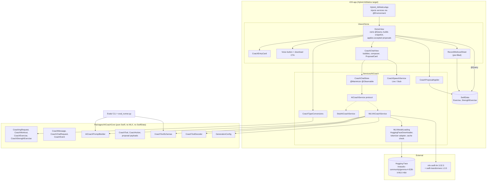
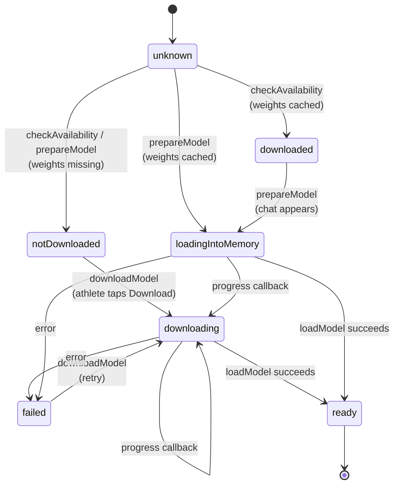
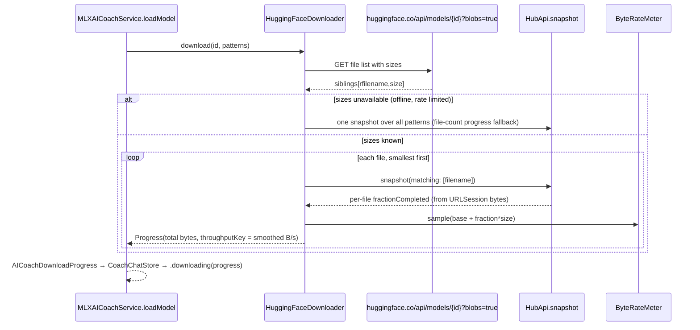
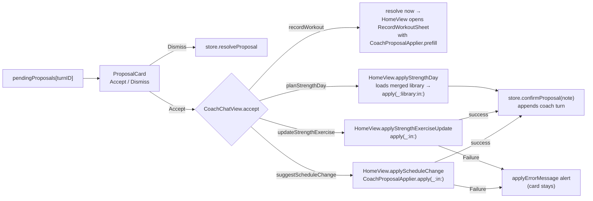
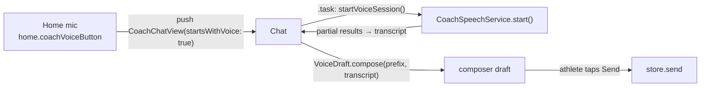
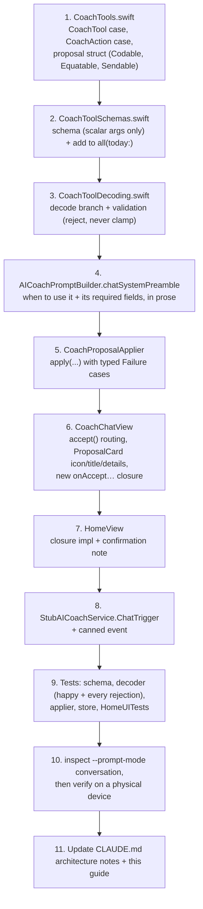

# AI Coach — Contributor Guide

Everything you need to know to work on the Hybrid AIthletics AI coach: what it is, how a message
becomes a model turn and a model turn becomes a change to the athlete's data, why the code is shaped
the way it is, and how to change it safely.

> **Read this first.** The coach runs a ~2B-effective-parameter model on the phone. Almost every
> unusual decision in this code traces back to one of two facts: a small model is *unreliable*
> (it guesses, repeats itself, and garbles structure), and a multi-gigabyte model is *expensive to
> deliver* (download, memory, launch time). The architecture is a set of guard rails around both.

---

## Contents

1. [What the coach is](#1-what-the-coach-is)
2. [Why on-device](#2-why-on-device)
3. [System map](#3-system-map)
4. [Module boundaries](#4-module-boundaries)
5. [Model and runtime](#5-model-and-runtime)
6. [Model delivery: download, cache, load](#6-model-delivery-download-cache-load)
7. [A conversational turn, end to end](#7-a-conversational-turn-end-to-end)
8. [Prompt anatomy](#8-prompt-anatomy)
9. [Tools](#9-tools)
10. [Decoding and validation](#10-decoding-and-validation)
11. [Proposals: accept, apply, confirm](#11-proposals-accept-apply-confirm)
12. [CoachChatStore](#12-coachchatstore)
13. [UI surfaces](#13-ui-surfaces)
14. [Voice entry](#14-voice-entry)
15. [Testing](#15-testing)
16. [Evals](#16-evals)
17. [Design invariants (do not regress)](#17-design-invariants-do-not-regress)
18. [How-to recipes](#18-how-to-recipes)
19. [Known gaps and gotchas](#19-known-gaps-and-gotchas)
20. [File index](#20-file-index)

---

## 1. What the coach is

The coach is a **tool-calling conversational assistant** that lives on the Home tab. An athlete can:

- **Ask about their training**: "Am I ramping up too fast?", "How did last week go?"
- **Change their running plan**: shorten, lengthen, retype, remove, or add a planned session.
- **Record a workout by describing it**: "I ran 5 miles this morning, felt strong."
- **Program strength work**: "Set up a full body day on Friday", "add face pulls to Tuesday".
- **Edit the strength board**: remove, move, offload, or bring back one exercise.

It can be reached by typing or by voice (the Home mic button).

**The coach never writes to the athlete's data directly.** Every mutating tool call becomes a
*proposal card* with Accept / Dismiss. Accepting a schedule or strength proposal applies it through
`CoachProposalApplier`. Accepting a workout proposal opens the normal record sheet, pre-filled, so the
athlete confirms the numbers before saving.

The conversation is **ephemeral**. It survives tab switches and navigation within a session and is
gone on relaunch. Nothing about the chat is persisted to SwiftData or CloudKit.

---

## 2. Why on-device

From [ADR 1](adrs/1-use-lightweight-onboard-llm.md). The app is a **one-time purchase**, so:

- Server-side inference would mean paying per-token forever for a user who paid once. That rules it out.
- A subscription contradicts the brand promise.
- Bring-your-own-API-key was rejected as bad UX.

That leaves a small model running locally. In return, the coach costs nothing per inference, works
offline after the first download, and keeps training data on the device. The price is a much lower
capability ceiling, a large one-time download, and tight memory limits on iOS.

> ADR 1's original Decision table records the April 2026 state (Gemma 3 4B, no tool use). Its
> **2026-10-14 amendment** covers the move to Gemma 4 E2B, the explicit-opt-in download, and tool
> calling. The cost reasoning is unchanged.

---

## 3. System map



---

## 4. Module boundaries

The code is in three layers, and the boundaries between them are enforced on purpose.

| Layer | Location | May import | Must NOT import | Why |
|---|---|---|---|---|
| **AICoachCore** | `Packages/AICoachCore/` | Foundation | MLX, SwiftData, SwiftUI, app code | Shared with the eval CLI; trivially unit-testable with `swift test` |
| **Coach services** | `Hybrid AIthletics/Services/AICoach/` | AICoachCore, MLX (gated), SwiftData | SwiftUI views | The only place MLX types exist |
| **Views** | `Hybrid AIthletics/Views/Home/` | AICoachCore, services via `@Environment` | MLX | Views pattern-match `CoachEvent`/`CoachAction`, never MLX `Generation` |

Consequences you will run into:

- **Duplicated enums.** `CoachExerciseType` mirrors the app's `ExerciseType`, and `CoachMuscleGroup`
  mirrors `MuscleGroup`. Their raw values are identical by design, and `CoachTypeConversions.swift`
  bridges them. The app→core direction force-unwraps for exercise types (a drift would crash in
  tests). The core→app direction falls back to `.other`, because the value came from a model.
- **Deliberately duplicated logic.** `AICoachPromptBuilder.feelingDescriptor` duplicates the app's
  `FeelingVisuals` wording. The decoder's sets range (1–20) and reps range (1–100) duplicate
  `StrengthPlanDraft`'s steppers. AICoachCore cannot import app code, so if you change one side,
  change the other.
- **`#if canImport(MLXLLM)`** gates every MLX line. The `#else` branches throw
  `AICoachError.notImplemented`, so the app compiles and launches where the SPM package isn't
  resolved.

---

## 5. Model and runtime

| | |
|---|---|
| **Model** | Gemma 4 E2B instruction-tuned, MLX 4-bit: `lmstudio-community/gemma-4-E2B-it-MLX-4bit` (~4.34 GB) |
| **Runtime** | `mlx-swift-lm` 3.32.3 (`MLXLLM`, `MLXLMCommon`) on `mlx-swift` 0.32.3 |
| **Hub / tokenizer** | `swift-transformers` 1.3.5 (`Hub`, `Tokenizers`), `swift-jinja` for chat templates |
| **Where** | `MLXAICoachService.modelID` and `configuration` |

```swift
ModelConfiguration(
    id: MLXAICoachService.modelID,
    extraEOSTokens: ["<turn|>"],   // Gemma 4's end-of-turn (Gemma 3 was <end_of_turn>)
    toolCallFormat: .gemma4        // <|tool_call> … <tool_call|> with <|"|> string escapes
)
```

**Why this exact repo.** The model type `gemma4` is multimodal. `MLXLLM.Gemma4Model` reads
`text_config` and drops the vision weights, so the model loads text-only. The smaller
`mlx-community/gemma-4-E2B-it-qat-mobile` (2.40 GB) is a Google QAT export with no `group_size`, and
mlx-swift-lm cannot load it. Every other Gemma 4 MLX build is 5.4 GB or larger. The header comment on
`modelID` has the full reasoning.

**Memory.** `loadModel()` sets `MLX.Memory.cacheLimit = 20 MB` before loading. Without that cap,
inference buffers accumulate until iOS jetsam kills the process mid-token. The 4.3 GB model is
heavier than the 3.0 GB Gemma 3 it replaced, so watch for jetsam on non-Pro devices. The app also
carries the `com.apple.developer.kernel.increased-memory-limit` entitlement.

**Generation parameters** live only in `AICoachCore/GenerationConfig.swift`:

| Preset | maxTokens | temperature | topP | repetitionPenalty | Used by |
|---|---|---|---|---|---|
| `production` | 400 | 0.4 | 0.9 | 1.2 | One-shot `suggestAdaptations` / `streamSuggestion` (evals) |
| `chat` | 512 | 0.6 | 0.95 | 1.2 | **The live chat** (`generateStreamingChat`) |
| `conservative` | 300 | 0.3 | 0.85 | 1.2 | Eval experiments |
| `lowerRepPenalty` | 400 | 0.4 | 0.9 | 1.2 | Eval experiments (now identical to `production`) |

Leave the repetition penalty at 1.2. Without it the model falls into degenerate looping.

**Streaming API.** Always use the `AsyncStream<Generation>` overload of `MLXLMCommon.generate`. The
old `didGenerate: ([Int]) -> …` callback passes a *cumulative* token array. Treating it as a delta
caused the quadratic, garbled output fixed in `1673cf4`.

**Sendability.** `UserInput` is not `Sendable`. Build it *inside* `container.perform { … }`, and
capture only Sendable values (`turns`, `tools`, `parameters`) across the hop.

---

## 6. Model delivery: download, cache, load

The weights are **never bundled**. The athlete has to opt in to downloading them, from a button. They
are cached under `HubApi.shared`'s download base and loaded offline after that.

### Phase state machine (`CoachModelPhase`)



Phase predicates used by the UI:

| Predicate | True for | Drives |
|---|---|---|
| `isReady` | `.ready` | `canSend`, composer enabled |
| `isBusy` | `.downloading`, `.loadingIntoMemory` | Guards against starting work twice |
| `needsDownload` | `.notDownloaded`, `.failed` | Download CTA, Home card glyph, voice CTA |
| `isUsable` | `.downloaded`, `.loadingIntoMemory`, `.ready` | Home card / mic not dimmed |

### Who triggers what

| Call | Called from | Downloads? | Loads into memory? |
|---|---|---|---|
| `checkAvailability(coach:)` | `HomeView.task` | No | No. It only checks the filesystem, so launch stays light |
| `prepareModel(coach:)` | `CoachChatView.task` | **Never** | Yes, if cached |
| `downloadModel(coach:)` | The chat's Download button only | Yes | Yes |

Opening the chat never starts a multi-gigabyte download on its own. That download could be on cellular.

### Byte-weighted progress (`HuggingFaceDownloader`)



Two approaches that look simpler and are wrong:

1. **One `snapshot` call over all patterns.** `HubApi` weights progress per *file*. The repo has one
   4.3 GB file and nine files totalling ~33 MB, so the bar hits 90% in seconds and then appears frozen.
2. **Polling the repo directory size.** `URLSession.download` writes to the *system temp directory*
   and `moveItem`s each file into place when it finishes. The directory shows nothing for minutes,
   then 4.3 GB at once. This approach shipped once and was reverted.

`ByteRateMeter` exponentially smooths the rate (α = 0.3, min interval 0.3 s, single-sample ceiling
500 MB/s). The rate and the derived `estimatedSecondsRemaining` let the card show "12 MB/s · 5 min
left". On a slow connection that line, not the bar, is what tells slow apart from hung.

### Cache check (`isHuggingFaceRepoCached`)

The model counts as cached only if all of these hold:

1. `config.json` exists, **and**
2. at least one `*.safetensors` file exists, which only appears after it has fully transferred, **and**
3. no `*.incomplete` file remains under `<repo>/.cache/huggingface/download`.

`config.json` on its own is not enough. It arrives in the first second, so an interrupted download
would claim to be cached and then fail to load.

`approximateDownloadBytes` (4,372,000,000) is hard-coded next to `modelID` so the CTA can show a size
before any network call. **Change both together.**

---

## 7. A conversational turn, end to end

```mermaid
sequenceDiagram
    actor A as Athlete
    participant V as CoachChatView
    participant H as HomeView
    participant S as CoachChatStore
    participant C as MLXAICoachService
    participant B as AICoachPromptBuilder / CoachToolSchemas
    participant R as mlx-swift-lm (Gemma 4)
    participant Dec as CoachToolDecoder

    A->>V: types / dictates, taps Send
    V->>S: send(text, coach, context: buildContext())
    Note over S: append .user + empty .coach turn<br/>context() evaluated only if !hasAttachedContext
    S->>H: buildCoachRequest() (autoclosure, first turn only)
    H-->>S: CoachingRequest (4 wk history, 2 wk plan, strength board)
    S->>C: streamChat(CoachChatRequest)
    C->>B: buildChatTurns(today: Date()), CoachToolSchemas.all(today:)
    B-->>C: [system preamble+date anchor, user(snapshot+msg), ...], tool schemas
    C->>R: UserInput(chat:, tools:) → generate(…, GenerationConfig.chat)
    loop stream
        R-->>C: .chunk(text)
        C-->>S: .textChunk → appended to coach turn
        R-->>C: .toolCall(call)
        C->>Dec: decode(name, arguments)
        alt valid
            Dec-->>C: CoachAction
            C-->>S: .action (reply → text; others → pendingProposals[turnID], first wins)
        else invalid
            Dec-->>C: CoachToolDecodeError
            C-->>S: .rejectedToolCall(reason) → italic "could you tell me the details again?"
        end
        R-->>C: .rejectedToolCall (runtime parse failure)
        C-->>S: .rejectedToolCall(reason)
    end
    S->>S: pruneEmptyTurn; set hasAttachedContext if first turn succeeded
    V->>A: bubble + ProposalCard (Accept / Dismiss)
```

What happens after Accept is covered in [§11](#11-proposals-accept-apply-confirm).

---

## 8. Prompt anatomy

All prompt text lives in `AICoachPromptBuilder` (AICoachCore). To see exactly what the model receives
for a scenario, without loading a model:

```bash
cd Evals && swift run CoachEval inspect --scenario high-rpe --prompt-mode conversation
```

### Turn structure

`buildChatTurns(for:today:calendar:)` returns:

```
[system]  chatSystemPreamble(today:)          ← every turn; includes the date anchor
[user]    buildDataSections(context) + "\n" + first athlete message   ← snapshot attached ONCE
[coach]   …
[user]    …
```

- **The system turn is rebuilt on every generation** with `Date()`. A conversation left open past
  midnight still resolves "today" correctly.
- **The training snapshot is attached once per conversation**, to the first user turn. Re-sending it
  every turn would use up the small model's context on repeated data. `CoachChatStore.hasAttachedContext`
  tracks this and is set only after the first turn *succeeds*. If that turn fails or is cancelled, the
  next one re-attaches. `clear()` resets it.
- **The date anchor lives in the system turn, not the snapshot**, because the snapshot only appears
  once.

### The chat system preamble

`chatSystemPreamble(today:)` contains, in order:

1. Persona: "experienced competitive running coach talking with your athlete".
2. **Date anchor**: "Today is 2026-11-04 Wednesday. Yesterday was … and tomorrow is …".
3. Rules:
   - Only reference listed workouts and sessions.
   - RPE (1–10) and feeling (1–5) are **independent**. Either may be missing, and neither implies the other.
   - Be brief and conversational.
   - Use the chat tool by default. Propose schedule changes only when asked, and record only workouts the athlete says they did.
   - Plan strength only when asked. One `plan_strength_day` call carries a whole day and appends. Use `update_strength_exercise` for one existing exercise. Both take weekday *names*.
   - Never invent a date, distance, or rating.
   - Every date is an absolute `YYYY-MM-DD` resolved from today, with "today" and "yesterday" spelled out as literal dates. Never copy a date from a tool description.
   - Gather every value before calling a tool, naming "can you record a workout for me" as the case that supplies none of them.
   - Required fields go **in** the call, never only in the reply text. Spells out the `plan_strength_day` exercise line format and states that **the coach** picks the exercises.
   - One tool call per reply.

There is also a legacy **`systemPreamble`** ("respond with 3–5 bullet points, under 200 words"). It
is used only by the one-shot `suggestAdaptations`/`streamSuggestion` path, which the evals still
score. The app no longer calls it. Don't merge the two: bullet-list instructions break conversation
and tool selection.

### The training snapshot (`buildDataSections`)

Built in `HomeView.buildCoachRequest()`:

| Section | Source | Window |
|---|---|---|
| Recent training | `Exercise` where `isCompleted`, converted with `CoachWorkout(from:)` | last 4 weeks → now |
| Upcoming plan | `Exercise` where `!isCompleted`, converted with `CoachExercise(from:)` | today → +2 weeks |
| Strength board | all `StrengthExercise`, `CoachStrengthExercise.snapshots(from:)` in board order | weekly template; **active lanes only** are rendered |

Example rendering:

```
Recent training (2 workouts):
- 2026-11-01 Sun Long Run, 10.0 mi, 1:32:00, RPE 7/10, felt strong — "windy"
- 2026-11-03 Tue Easy Run, 4.0 mi, 36:00, RPE 3/10

Upcoming plan (1 scheduled):
- 2026-11-06 Fri Tempo Run, 6.0 mi, 48:00

Strength board (weekly plan, 2 exercises):
- Monday: Barbell Back Squat (Quads), 3×5
- Friday: Barbell Bench Press (Chest)

<athlete's first message>
```

Rules encoded in the line formatters:

- RPE and feeling are each emitted **verbatim** and **omitted entirely when `nil`**. There is no
  inversion or derivation (there used to be one, and it was wrong; see `30f078f`).
- Distances render in km or mi from `useMetricUnits`, but tools always take **miles**.
- An offloaded strength exercise is left out, so the coach won't plan around work the athlete set aside.
- The sets×reps badge appears only when both values are set.
- Strength *lift history* (`CoachStrengthExercise.workouts`) and notes are carried in the snapshot
  type but **not rendered** in the prompt yet.

---

## 9. Tools

Five tools, defined across three files that must stay in sync:

| File | Role |
|---|---|
| `CoachTools.swift` | `CoachTool` (names), `CoachAction` (decoded result), proposal payload structs |
| `CoachToolSchemas.swift` | JSON Schema dictionaries passed to the chat template. Plain `[String: any Sendable]`, no MLX import |
| `CoachToolDecoding.swift` | Raw call → validated `CoachAction` |

Schemas are presented in this order: `chat` first (so the default reading is "just reply"), then
`suggest_schedule_change`, `plan_strength_day`, `update_strength_exercise`, `record_workout`.

| Tool | Becomes | Required args | Optional args | Target |
|---|---|---|---|---|
| `chat` | `.reply(String)` → appended as text | `message` | — | — |
| `suggest_schedule_change` | `ScheduleChangeProposal` | `date`, `kind`, `rationale` | `distance_miles`, `duration_seconds`, `exercise_type` | One planned `Exercise` on a calendar day |
| `record_workout` | `WorkoutProposal` | `date`, `exercise_type` (+ distance **or** duration, enforced by the decoder) | `perceived_exertion`, `feeling`, `notes` | A new recorded `Exercise` (via the sheet) |
| `plan_strength_day` | `StrengthDayProposal` | `weekday`, `exercises`, `rationale` | — | Append to one weekday lane |
| `update_strength_exercise` | `StrengthExerciseUpdateProposal` | `weekday`, `exercise`, `change`, `rationale` (+ `new_weekday` for moves) | — | One existing `StrengthExercise` |

`ScheduleChangeKind`: `adjust_distance`, `adjust_duration`, `change_type`, `remove`, `add`.
`StrengthExerciseChangeKind`: `remove`, `move_to_day`, `offload`, `onboard`.
Weekdays are `Sunday`…`Saturday` → lane index 0…6 (`StrengthDayProposal.weekdayNames`).

### Schema design rules (learned the hard way)

- **Date descriptions name today.** `dateFormatDescription(today:)` reads "an absolute calendar date as
  YYYY-MM-DD, where today is 2026-11-04". A fixed example such as `"e.g. 2026-04-06"` was being copied
  verbatim into calls as the workout date (`b5419a7`).
- **Strength tools take weekday names, never dates.** The strength board is a weekly template, and
  athletes phrase requests that way.
- **`plan_strength_day.exercises` is a flat string, not an array of objects.** The Gemma 4 dialect
  writes strings with a `<|"|>` escape marker. mlx-swift-lm's `GemmaFunctionParser` unwraps that
  marker only for *scalar* values. A value starting with `[` falls through to `BareKeyJSONParser`,
  which can't read the markers, so a correctly formed nested call arrived as one raw string and failed
  decode every time. The flat format matches the strength-board lines the prompt already shows, and
  the model copies it readily:
  ```
  Barbell Back Squat (Quads), 3x5; Push-Up (Chest), 3x10; Plank (Core)
  ```
  **Keep every new tool argument scalar** (string, number, integer, string enum).
- **Batch a whole day into one call.** Because the first proposal of a turn wins, splitting a day
  across calls would silently drop everything after the first.
- **Repeat required fields in prose.** A 4B model reads the schema's `required` array weakly. The
  preamble lists each tool's required fields, and the `exercises` description starts with `REQUIRED`.
  The decoder is still the enforcement underneath.

---

## 10. Decoding and validation

`MLXAICoachService.coachEvent(from:)` maps the runtime's `ToolCall` arguments with `.anyValue` and
calls `CoachToolDecoder.decode(name:arguments:)`.

**Don't use the runtime's `ToolCall.execute(with:)`.** It builds a default `JSONDecoder`, whose date
strategy expects seconds since 2001, so `"2026-04-06"` fails.

The decoder **rejects, never clamps**. Every failure becomes a `CoachToolDecodeError`, which becomes
`.rejectedToolCall(reason:)`, which shows up in the transcript. It never crashes and never quietly
"fixes" a value.

| Check | Rule |
|---|---|
| Unknown function name | `unknownTool` |
| Strings | Trimmed; whitespace-only counts as missing |
| Dates | `yyyy-MM-dd`, POSIX locale, current time zone |
| Numbers | Accept `Double`, `Int`, or numeric `String`; distance/duration must be finite and ≥ 0 |
| `perceived_exertion` | Integer 1–10, else rejected |
| `feeling` | Integer 1–5, else rejected |
| Exercise type | Exact raw value of `CoachExerciseType` (`"Easy Run"`, not `"easy run"`) |
| Weekday / muscle group | Case-insensitive match |
| `suggest_schedule_change` | `adjust_distance` needs distance; `adjust_duration` needs duration; `change_type` and `add` need type |
| `record_workout` | Needs distance **or** duration. "Can you record a workout for me" must go back to chat (`1e28767`) |
| `plan_strength_day` | 1…8 exercises (`maxExercises`). The string path splits on `;` or newline; the muscle group comes from the **last** parenthesized span (`"Pull-Up (Assisted) (Back)"` works); `NxM` or `N×M` with sets 1–20 and reps 1–100, both or neither. A real JSON array of objects is still accepted as a fallback |
| `update_strength_exercise` | `move_to_day` needs `new_weekday`, which must differ from `weekday` |

Rejections reach the athlete as:

> _I started to suggest something there but didn't have it right (reason) — could you tell me the details again?_

The wording is a request rather than an error message because the most common rejection is a call
made before the athlete had given every value.

---

## 11. Proposals: accept, apply, confirm



`CoachChatView` has no `ModelContext` of its own. It hands accepted proposals to closures that
`HomeView` supplies, because `HomeView` owns the queries and the context (the project's no-ViewModels
rule).

### `CoachProposalApplier` behaviour

**Schedule changes** target the single `Exercise` on the proposal's calendar day:

| Situation | Result |
|---|---|
| 0 sessions that day | `Failure.noSessionOnDate` (never invents one) |
| 2+ sessions that day | `Failure.ambiguousDate` |
| Session already recorded | `Failure.alreadyRecorded` |
| `change_type` | Updates type; renames only if the name was just the old type's label |
| `remove` on a series member | `ExercisePlanner.detach` first, then delete |
| `add` on a day that has something | `Failure.dateAlreadyScheduled` |
| `add` | New `Exercise` with the rationale as its notes |

**Strength day** (`apply(_:library:in:)`). This never throws:

- Appends at the end of the weekday's **active** lane (`StrengthBoardPlanner.nextSortOrder`).
- Matches names case-insensitively against the merged library (bundled + user). A match keeps
  `libraryExerciseID` and the canonical muscle group. A non-match becomes a plain entry with the
  proposed group.
- **Skips** names that already exist in that lane's active section (and duplicates within the
  proposal). It never duplicates or replaces.
- Returns `StrengthDayOutcome(inserted:skipped:)`, which `HomeView.strengthDayConfirmation` turns into
  the confirmation note.

**Strength update** (`apply(_:in:)`). Resolves the name within the weekday lane, case-insensitively:

| Change | Searches | Effect |
|---|---|---|
| `remove` | active, then offloaded | delete (including its lift history) |
| `offload` | active only | `StrengthBoardPlanner.move` → offloaded section, same day |
| `onboard` | offloaded only | → active section, same day |
| `move_to_day` | active, then offloaded | → destination day, **same section**; `Failure.strengthExerciseAlreadyInLane` if the name is already there |

A name that isn't found throws `Failure.strengthExerciseNotFound`. The applier never invents an exercise.

**Workout proposals** are never written by the applier. `prefill(from:)` maps the proposal to
`WorkoutPrefill`, keeping `nil` RPE and feeling as `nil` (not recorded), and `RecordWorkoutSheet`
populates its form from it. The athlete saves through the normal path.

---

## 12. CoachChatStore

`@MainActor @Observable`, created once in `Hybrid_AIthleticsApp` and injected via
`@Environment(\.coachChat)`. Like `GoogleSheetsSyncCoordinator`, it is app-scope state, **not a
ViewModel**: it owns no queries and makes no view decisions.

| State | Meaning |
|---|---|
| `messages` | Transcript, oldest first, no `.system` turn |
| `pendingProposals: [UUID: CoachAction]` | Keyed by the coach turn that carried the proposal |
| `isGenerating`, `generationTask` | In-flight turn; `cancel()` stops consuming it |
| `modelPhase` | See [§6](#6-model-delivery-download-cache-load) |
| `errorMessage` | Last generation error, cleared on the next send |
| `hasAttachedContext` | Snapshot-once bookkeeping |

Behavioural rules:

- **The first proposal of a turn wins.** A small model often emits the same call two or three times
  in one pass, each slightly different. Later `.action`s are ignored so the card can't change while
  the athlete is about to tap it (`a309d94`). Text keeps streaming either way.
- **`.action(.reply)`** from the `chat` tool is appended as text. It isn't a proposal.
- **Empty turns are pruned.** A coach turn with no text and no proposal is removed after the stream ends.
- **Cancellation isn't an error.** `CancellationError` is swallowed, and text that already arrived stays.
- **`send` takes `context` as an `@autoclosure`**, so the snapshot (which filters every `Exercise`) is
  built only on the turn that attaches it.
- **`clear()`** cancels, empties the transcript and proposals, and re-arms the snapshot.

---

## 13. UI surfaces

| Surface | File | Notes |
|---|---|---|
| Home coach card | `Views/Home/CoachEntryCard.swift` | Shows the last coach reply as a preview. Dimmed with a download glyph and subtitle unless `isUsable`. Shows `%` while downloading |
| Voice button + CTA | `HomeView.voiceEntryButton`, `voiceDownloadCTA` | Mic is disabled unless `isUsable`. The slim CTA links to the chat's download prompt |
| Chat | `Views/Home/CoachChatView.swift` | Phase cards (download CTA, progress, "starting up"), suggestion chips on an empty transcript, bubbles, error and speech notices, composer with mic, Stop/Clear toolbar |
| Proposal card | `ProposalCard` in `CoachChatView.swift` | Per-tool icon, title, and summary lines so the athlete can check what the coach heard |
| Pre-filled record sheet | `Views/AerobicTraining/RecordWorkoutSheet.swift` (`prefill:`) | Shared with normal recording |

There is a single `coachChatView(startsWithVoice:)` builder in `HomeView` behind every entry point
(card, mic, CTA), so they can't drift apart.

Accessibility identifiers used by UI tests:

```
home.coachCard  home.coachVoiceButton  home.coachVoiceDownloadCTA
coach.chat.input  coach.chat.send  coach.chat.mic  coach.chat.stop  coach.chat.clear
coach.chat.download  coach.chat.downloadPrompt  coach.chat.downloadProgress  coach.chat.loading
coach.chat.proposal  coach.chat.accept  coach.chat.dismiss
coach.chat.bubble.user  coach.chat.bubble.coach
```

---

## 14. Voice entry



- `CoachSpeechService` (`@MainActor` protocol) has two implementations. `LiveCoachSpeechService` uses
  `SFSpeechRecognizer` + `AVAudioEngine` and requires on-device recognition where the device supports
  it. `StubCoachSpeechService` is used for previews and tests.
- Dictation **never auto-sends**. The transcript fills the composer for the athlete to review.
- `VoiceDraft.compose` appends dictation to whatever was typed before recording started, joined by
  exactly one space. A blank transcript leaves typed text alone.
- Permission refusals go to `errorMessage` with a pointer to Settings, and typing still works.
  `Info.plist` holds `NSMicrophoneUsageDescription` and `NSSpeechRecognitionUsageDescription`.
- Leaving the chat stops capture. Sending stops and resets it.

---

## 15. Testing

The project rule from `CLAUDE.md`: **every new feature ships with unit tests, at least one per public method.**

### Where the tests are

| Suite | File | Covers |
|---|---|---|
| `AICoachPromptBuilderTests`, `GenerationConfigTests`, formatting tests | `Packages/AICoachCore/Tests/AICoachCoreTests/PromptBuilderTests.swift` | Line formats, omission rules, metric/imperial, strength section, presets |
| `CoachToolSchemaTests`, `CoachToolDecoderTests`, `CoachProposalCodableTests`, `CoachChatPromptTests` | `…/CoachToolTests.swift` | Schema shape, every decode path and rejection, chat turns, date anchor |
| `CoachTypeConversionTests`, `CoachStrengthConversionTests` | `Hybrid AIthleticsTests/Hybrid_AIthleticsTests.swift` | SwiftData ↔ core bridging |
| `CoachProposalApplierTests` | same | Every apply path and failure |
| `CoachChatStoreTests` | same | Phases, send/stream, first-proposal-wins, snapshot-once, clear |
| `StubAICoachServiceTests`, `AICoachDownloadProgressTests`, `HuggingFaceDownloadPatternTests`, `ByteRateMeterTests`, `VoiceDraftTests`, `StubCoachSpeechServiceTests` | same | Service doubles and helpers |
| `HomeUITests` | `Hybrid AIthleticsUITests/HomeUITests.swift` | Chat send, proposals, accept/dismiss, rejection, clear, persistence across navigation, voice, the download CTA and progress flow |

```bash
cd Packages/AICoachCore && swift test                    # fast, no simulator
xcodebuild test -scheme "Hybrid AIthletics" -destination 'platform=iOS Simulator,name=iPhone 17 Pro' -only-testing:"Hybrid AIthleticsTests"
xcodebuild test -scheme "Hybrid AIthletics" -destination 'platform=iOS Simulator,name=iPhone 17 Pro' -only-testing:"Hybrid AIthleticsUITests/HomeUITests"
```

### Stubs and launch arguments

- `@Environment(\.aiCoach)` and `@Environment(\.coachSpeech)` **default to the stubs**, so previews
  never load MLX or touch the microphone.
- `-uiTestSeed` injects `StubAICoachService()` (cached, ready on load), `StubCoachSpeechService`, and an
  in-memory container with `UITestFixtures`.
- `-uiTestCoachNotDownloaded` injects `StubAICoachService(isModelCached: false)`, which simulates a
  10-step download at a fixed 12 MB/s so the CTA and progress UI can be tested with no network.

`StubAICoachService.streamChat` picks its output by keyword in the last user turn
(`StubAICoachService.ChatTrigger`):

| Phrase contains | Stub emits |
|---|---|
| `garble` | `.rejectedToolCall` |
| `record` | text + `record_workout` (today, Easy Run, 5 mi, 45 min, RPE 4) |
| `change my plan` | text + `adjust_distance` to 4 mi today |
| `strength day` | text + Friday full-body day (3 exercises) |
| `update strength` | text + move fixture `"Test Lift 1"` from today's lane to today+2 |
| anything else | echoes `You asked: "…"` + canned narrative |

When you add a tool, add a trigger here too.

### What tests can't tell you

None of these tests run the real model. **Verify model-facing changes (prompt wording, schemas, new
tools) on a physical device** with an Xcode build. SPM command-line builds don't compile the Metal
shaders, so Swift-CLI MLX inference produces garbage. The `/verify` skill drives the simulator, and
the stub there covers UI wiring only.

---

## 16. Evals

`Evals/` holds a Swift CLI (`CoachEval`) and a Python runner (`eval_runner.py`). See
[`Evals/README.md`](../Evals/README.md).

- **`swift run CoachEval inspect --prompt-mode flat|chat|conversation`** prints the exact prompt from
  AICoachCore. `conversation` prints the tool-calling chat turns and tool schemas. It needs no model
  and is the fastest way to review prompt changes.
- **`python3 eval_runner.py`** gets prompts from the Swift CLI and generates with Python `mlx-lm`
  (Swift CLI builds can't run Metal). It scores the **one-shot** bullet-list output on a 100-point
  rubric (length, repetition, bullets, actionable verbs, hallucination, ending).

**Limitations:**

- Evals still pin **Gemma 3 4B** (`MODEL_ID` in `eval_runner.py`) and mlx-swift-lm 2.x, so **scores
  don't reflect the production model**.
- They score the **legacy one-shot path**, not tool selection or argument quality. There is no
  automated eval of the tool-calling chat yet. Building one is a high-value contribution: scenario →
  expected tool + arguments, scored through `CoachToolDecoder`.

---

## 17. Design invariants (do not regress)

Each of these exists because the opposite shipped, or nearly shipped, and broke.

1. **Mutating tools propose, never write.** Accept and Dismiss for everything. Workouts go through the
   pre-filled sheet.
2. **Reject, never clamp.** Out-of-range ratings, sets, reps, or dates become visible rejections.
3. **`feeling` (1–5) and `perceivedExertion` (1–10) are independent `Int?`.** Emit each verbatim, omit
   when `nil`, and never derive one from the other.
4. **The model has no clock.** Today goes in the system turn and in every date argument description, on
   every turn. Never put a fixed example date in a schema.
5. **A tool call is the last step.** Gather the date, type, and size before calling `record_workout`.
   The decoder enforces distance-or-duration.
6. **Tool arguments stay scalar.** Nested arrays and objects don't survive the Gemma 4 dialect parser.
7. **The first proposal of a turn wins.**
8. **One `plan_strength_day` call per day, append-only, skip duplicates.**
9. **Strength tools take weekday names; schedule tools take `YYYY-MM-DD`.**
10. **Decode with `CoachToolDecoder`, never `ToolCall.execute(with:)`.**
11. **The download is always explicit.** `prepareModel` and `checkAvailability` never download.
12. **Progress is byte-weighted, per file.** Don't collapse it to one `snapshot` or poll the directory.
13. **The cache check requires `.safetensors` and no `.incomplete` file.**
14. **No MLX outside `Services/AICoach/`, and all of it behind `#if canImport(MLXLLM)`.**
15. **The snapshot attaches once per conversation; the system turn rebuilds every turn.**
16. **Previews and tests default to stubs.** `-uiTestSeed` must never reach the real model or microphone.
17. **`MLX.Memory.cacheLimit` stays capped** before loading.

---

## 18. How-to recipes

### Add a new tool



Because `CoachAction` is an exhaustive switch, the compiler points you at most of the places in steps
6–7.

### Change prompt wording

1. Edit `AICoachPromptBuilder` (or a schema description).
2. Check it with `swift run CoachEval inspect --scenario high-rpe --prompt-mode conversation`.
3. Update `PromptBuilderTests` / `CoachChatPromptTests` assertions.
4. Test the change in conversation on a device. Small wording changes can noticeably shift tool
   selection in a 4B model.

### Add data to the coach's snapshot

1. Add the field to the AICoachCore value type (`CoachWorkout`, `CoachExercise`, or
   `CoachStrengthExercise`), with a default in `init` so existing callers compile.
2. Populate it in `CoachTypeConversions.swift`.
3. Render it in the relevant line formatter, omitting it when empty or `nil`.
4. Test each output variant (present, absent, metric/imperial).
5. Keep the context cost in mind: the snapshot is the largest part of the prompt.

### Swap the model

1. Change `MLXAICoachService.modelID` **and** `approximateDownloadBytes`.
2. Match `ModelConfiguration.toolCallFormat` and `extraEOSTokens` to the model family.
3. Confirm the repo is an MLX conversion that mlx-swift-lm can load (it needs `group_size`,
   `.scales`, and `.biases`).
4. Re-check the memory headroom on the smallest supported device.
5. Re-check the tool-dialect argument parsing: the scalar-only rule is specific to Gemma 4.
6. Update `Evals/eval_runner.py` `MODEL_ID`, `CLAUDE.md`, the ADR, and this guide.
7. Bump `CoachModelPhase` copy only if the download size changes noticeably.

### Swap the runtime (e.g. LiteRT-LM)

Write a new `AICoachService` conformance that yields `CoachEvent`s, decodes through
`CoachToolDecoder`, and builds turns with `AICoachPromptBuilder.buildChatTurns`. Inject it in
`Hybrid_AIthleticsApp.makeCoachForLaunch()`. No view or store code should need to change.

---

## 19. Known gaps and gotchas

**Deliberate mismatch**

- `Evals/` (`eval_runner.py` `MODEL_ID` and `CoachGenerator.modelID`) still runs **Gemma 3 4B QAT** on
  mlx-swift-lm 2.x and scores only the one-shot prompt. This is documented in the Evals README and
  the code. Moving the evals to Gemma 4 and adding tool-call scoring is open work ([§16](#16-evals)).

**Behavioural gaps worth knowing**

- **Tool calls aren't in the transcript the model sees.** `CoachMessage` carries only text, so on later
  turns the model doesn't know it proposed something or whether the athlete accepted it, apart from
  confirmation notes, which are appended as coach turns.
- **The transcript is sent whole on every turn**, with no truncation or summarisation. Very long
  conversations will eventually push the snapshot out of the effective context.
- **Workout proposals get no confirmation note.** `CoachChatView.accept` resolves the card as soon as
  Accept opens the pre-filled sheet, and `ProposedWorkoutRequest.messageID` is carried but not yet read.
  Cancelling the sheet loses the proposal, and saving adds nothing to the transcript.
- **Stop may not stop the GPU.** `cancel()` stops the store from consuming the stream, but
  `MLXAICoachService`'s `AsyncThrowingStream` sets no `onTermination` to cancel its producer `Task`, so
  generation probably runs on to `maxTokens` in the background.
- **Metric users:** the prompt shows km, but `distance_miles` arguments are miles, so the model has to
  convert. Watch for unit mistakes in proposals from metric athletes.
- **Strength lift history and notes** are in the snapshot type but not rendered in the prompt.
- **Schedule changes can't choose between two sessions on one day**. They fail as `ambiguousDate`.

---

## 20. File index

| Path | What it is |
|---|---|
| `Packages/AICoachCore/Sources/AICoachCore/AICoachPromptBuilder.swift` | Preambles, date anchor, snapshot sections, chat turn assembly |
| `…/CoachChat.swift` | `CoachRole`, `CoachMessage`, `CoachChatRequest`, `CoachEvent` |
| `…/CoachTools.swift` | Tool vocabulary, `CoachAction`, all proposal payloads |
| `…/CoachToolSchemas.swift` | JSON Schemas for the five tools |
| `…/CoachToolDecoding.swift` | `CoachToolDecoder`, `CoachToolDecodeError` |
| `…/CoachingRequest.swift`, `CoachWorkout.swift`, `CoachExercise.swift`, `CoachStrengthExercise.swift` | Snapshot value types |
| `…/CoachExerciseType.swift`, `CoachMuscleGroup.swift` | Core mirrors of app enums |
| `…/GenerationConfig.swift` | Sampling presets |
| `…/DistanceFormatting.swift`, `DurationFormatting.swift` | Prompt formatting helpers |
| `Hybrid AIthletics/Services/AICoach/AICoachService.swift` | Protocol, `AICoachDownloadProgress`, `AICoachError` |
| `…/MLXAICoachService.swift` | Production service: model config, load, chat generation, tool-call decode |
| `…/MLXModelLoading.swift` | `HuggingFaceDownloader`, `ByteRateMeter`, tokenizer loader + adapter, `isHuggingFaceRepoCached` |
| `…/StubAICoachService.swift` | Deterministic double with `ChatTrigger`s and simulated download |
| `…/CoachChatStore.swift` | `CoachModelPhase`, `CoachChatStore` |
| `…/CoachProposalApplier.swift` | Applies accepted proposals, `WorkoutPrefill` |
| `…/CoachTypeConversions.swift` | SwiftData → AICoachCore bridges |
| `…/CoachSpeechService.swift`, `LiveCoachSpeechService.swift`, `StubCoachSpeechService.swift` | Dictation |
| `Hybrid AIthletics/Config/AICoachEnvironment.swift`, `CoachChatEnvironment.swift`, `CoachSpeechEnvironment.swift` | Environment keys (stub defaults) |
| `Hybrid AIthletics/Hybrid_AIthleticsApp.swift` | Root injection, `-uiTestSeed` / `-uiTestCoachNotDownloaded` |
| `Hybrid AIthletics/Views/Home/HomeView.swift` | Snapshot builder, proposal application, entry points |
| `Hybrid AIthletics/Views/Home/CoachChatView.swift` | Chat UI, `CoachMessageBubble`, `ProposalCard` |
| `Hybrid AIthletics/Views/Home/CoachEntryCard.swift` | Home card |
| `Evals/` | Prompt inspection CLI and Python eval runner |
| `docs/adrs/1-use-lightweight-onboard-llm.md` | Why on-device |
