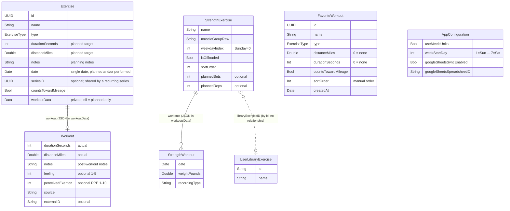
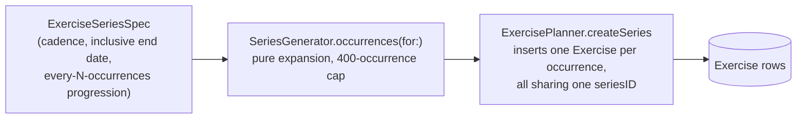

# Data Model Reference

This document provides a detailed reference for the Hybrid AIthletics data model. It is written for senior engineers who may not have direct experience with Swift or SwiftData and need to understand the persistence layer, relationships, and design rationale.

## Technology Overview

Hybrid AIthletics uses **SwiftData**, Apple's ORM framework built on top of Core Data. If you're coming from other ecosystems:

- SwiftData is analogous to **SQLAlchemy** (Python), **ActiveRecord** (Ruby), or **Entity Framework** (.NET). It maps Swift classes to persistent storage (SQLite under the hood) and handles schema creation, migrations, and object lifecycle.
- The `@Model` macro (similar to a decorator/annotation) marks a class as a persistent entity. SwiftData inspects the class's properties at compile time and generates the necessary storage schema.
- **CloudKit sync** is layered on top — SwiftData can automatically mirror local records to Apple's cloud database so data syncs across a user's devices. This imposes a constraint: **every property must have a default value**, because CloudKit may deliver partial records during sync.

## Entity-Relationship Diagram

The persisted `@Model` entities are `Exercise`, `StrengthExercise`, `UserLibraryExercise`, `FavoriteWorkout`, and `AppConfiguration` (`ModelContainerFactory`'s schema). Recorded-instance data does **not** get its own table: `Exercise.workout` is a `Workout` value struct and `StrengthExercise.workouts` is a `[StrengthWorkout]` array, each JSON-encoded into a `Data?` column on its owner. An exercise with `workout == nil` is planned only; a non-nil `workout` means it was recorded.



`ExerciseType` is an enum (13 cases), not a table; it is stored as its `String` raw value. The strength models are covered in depth in [STRENGTH_TRAINING.md](STRENGTH_TRAINING.md).

## Entities

### Exercise

**File:** `Models/Exercise.swift`

An Exercise represents a **single training activity** — planned, recorded, or both. The planning fields always apply; once the activity has been performed, the recorded-only data lives in the nested `workout` value object. Think of it as a calendar event ("5K Run on Monday") that carries its own completion record once done.

| Property | Type | Default | Description |
|----------|------|---------|-------------|
| `id` | `UUID` | Auto-generated | Primary key. Also used as the drag-and-drop transfer payload (only the UUID is serialized during drag, not the full object) and as the list-row / navigation identity. |
| `name` | `String` | `""` | User-facing label, e.g. "Morning 5K", "Tempo Thursday". |
| `type` | `ExerciseType` | `.run` | Activity category. Stored as the enum's `String` raw value in the database (e.g. `"Tempo Run"`). See [ExerciseType](#exercisetype) below. |
| `durationSeconds` | `Int` | `0` | **Planned (target)** duration. Stored in seconds to avoid floating-point precision issues. The UI decomposes this into hours/minutes/seconds for display and editing. The *actual* recorded duration lives in `workout.durationSeconds`. |
| `distanceMiles` | `Double` | `0.0` | **Planned (target)** distance in **miles** — the canonical storage unit regardless of user preference. The *actual* recorded distance lives in `workout.distanceMiles`. See [Distance Convention](#distance-convention). |
| `notes` | `String` | `""` | Free-text notes about the *planned* exercise. Post-workout notes live in `workout.notes`. |
| `date` | `Date` | `Date()` | The **single** date for this activity — the day it is planned and/or performed (renamed from the old `scheduledDate`). Preserves the full timestamp so the History tab can show time-of-day. **Not** normalized to midnight; day/week grouping flows through `Date+Week` helpers (`startOfDay`, `startOfWeek`, `isSameDay`), which compare calendar components. If an activity is performed on a different day than planned, it is treated as a separate `Exercise` — there is no plan-date / done-date split. |
| `seriesID` | `UUID?` | `nil` | Shared by every exercise bulk-created as one recurring series; `nil` for a one-off. See [Recurring Series](#recurring-series). |
| `countsTowardMileage` | `Bool` | `true` | `false` keeps the activity (e.g. a casual walk) out of mileage aggregates — weekly totals, stat cards, charts. It renders as a hollow calendar dot and a dimmed History row with a "Not training" badge. |
| `workout` | `Workout?` | `nil` | Recorded-instance data, present once the activity has been performed. `nil` means *planned only*. JSON-encoded into a private `workoutData: Data?` column on the same record — no second table. See [Workout](#workout) below. |
| `isCompleted` | `Bool` (computed) | — | `workoutData != nil` (equivalent to `workout != nil`, without decoding). The single source of truth for "has this been recorded?". |

**Initialization behavior:** The initializer stores `date` as provided (no midnight normalization). Planned-creation flows pass a day-level date; recorded flows (record sheet, imports) pass the real performed date/timestamp.

---

### Workout

**File:** `Models/Workout.swift`

A Workout holds the **recorded-instance data** for an Exercise — the metrics that only exist once the activity has actually been performed. It is **not** a SwiftData `@Model`: it is a plain `Codable` value `struct` persisted inline on its `Exercise` as JSON in a private `workoutData: Data?` column (CloudKit mirrors it as a blob; no separate table). It is deliberately **not** stored as a `Workout?` Codable composite attribute: SwiftData's composite decoder `fatalError`s when fetching an optional value struct. The activity's date, name, and type live on the owning `Exercise`.

| Property | Type | Default | Description |
|----------|------|---------|-------------|
| `durationSeconds` | `Int` | `0` | **Actual** recorded duration in seconds. |
| `distanceMiles` | `Double` | `0.0` | **Actual** recorded distance in miles. Same storage convention as Exercise. |
| `notes` | `String` | `""` | Post-workout notes (e.g. "felt great", "knee pain at mile 2"). |
| `feeling` | `Int?` | `nil` | How the athlete felt, on a 1–5 scale (1 = Very Weak, 5 = Very Strong). `nil` means not recorded. Feeds the on-device AI Coach — see [AI Coach Input](#ai-coach-input) below. |
| `perceivedExertion` | `Int?` | `nil` | Rate of Perceived Exertion, 1–10 (1 = Very Easy, 10 = Maximum Effort). `nil` means not recorded. **Independent of `feeling`** — see below. |
| `source` | `String` | `"Manual"` | Provenance — the raw value of a `WorkoutSource` (`"Manual"`, `"CSV"`, `"Apple Exercise App"`). Stored as String for forward-extensibility. Read type-safely via `workout.workoutSource`. |
| `externalID` | `String?` | `nil` | Stable identifier from the external source (e.g. `HKWorkout.uuid.uuidString`). Used for deduplication on re-import. `nil` for manual and CSV entries. |

**Editable surface:** When editing a recorded exercise from the History tab (`WorkoutDetailSheet`), the user can change name/type/date plus the recorded actuals (duration, distance, notes, feeling, perceived exertion). `source` and `externalID` are intentionally hidden — they are import-pipeline provenance/dedup metadata; mutating them would break dedup on re-import. The mutation logic is factored into a stateless `WorkoutEditor` helper (`Views/History/WorkoutDetailSheet.swift`): `WorkoutEditor.apply(_:to:)` writes the identity fields onto the `Exercise` and **rebuilds** its `workout` struct from the edited actuals while **preserving** `source` and `externalID`. It is unit-testable without a SwiftUI view.

**Initializer: `Workout(draftFrom:)`**

Creates a recorded workout pre-filled with the actuals copied from a planned exercise's targets (`durationSeconds`, `distanceMiles`), starting unrated (both `feeling` and `perceivedExertion` are `nil`), with empty notes and a `manual` source. This is the entry point when a user taps "Record Workout" on a planned exercise; the recorded `workout` is then attached to that exercise. The user can edit every field before saving.

#### AI Coach Input

`feeling` and `perceivedExertion` are what let the on-device AI Coach distinguish between *planned* workload and *experienced* workload. They are deliberately **two fields, not one**: how hard a session was and how the athlete felt through it are independent signals. Two athletes can run the same 5-mile tempo at the same pace and experience it very differently, and the same athlete can log an RPE 9 feeling strong (a good session) or feeling weak (an overreaching flag). Collapsing them loses exactly that distinction.

When the coach serializes recent workouts into its prompt (see `Packages/AICoachCore/Sources/AICoachCore/AICoachPromptBuilder.swift`), each rating is emitted verbatim and omitted entirely when `nil` — never defaulted or derived from the other. The chat system preamble tells the model that the two are independent and that either may be missing:

```
- 2026-07-28 Tue Long Run, 12.0 mi, 1:30:00, RPE 9/10, felt very weak — "had to walk last mile"
- 2026-07-29 Wed Easy Run, 4.0 mi, 35:00, RPE 8/10
```

`HomeView.buildCoachRequest()` builds the coach's "recent workouts" from completed exercises (`isCompleted`) in the last 4 weeks and its "upcoming exercises" from planned-only ones in the next 2 weeks; `CoachWorkout(from:)` reads the exercise's `date`/`type` plus the recorded `workout` metrics. A coach `record_workout` proposal carries the same two independent optionals and pre-fills `RecordWorkoutSheet` with them, so an unstated rating stays unrecorded. See [docs/AI_COACH.md](AI_COACH.md) for the coach and [docs/adrs/1-use-lightweight-onboard-llm.md](adrs/1-use-lightweight-onboard-llm.md) for the broader architectural decision.

---

### FavoriteWorkout

**File:** `Models/FavoriteWorkout.swift`

A saved aerobic workout preset. Picking one pre-fills the record (quick add) and schedule sheets with its identity and targets. It is a preset, not a workout: it has no relationship to `Exercise`, carries no date, notes or ratings, and is not exported to Google Sheets.

| Property | Type | Default | Description |
|----------|------|---------|-------------|
| `id` | `UUID` | `UUID()` | Unique identifier. |
| `name` | `String` | `""` | Display name. Duplicates are allowed. |
| `type` | `ExerciseType` | `.run` | Exercise type to pre-fill. |
| `distanceMiles` | `Double` | `0.0` | Target distance in miles; `0` means none. |
| `durationSeconds` | `Int` | `0` | Target duration; `0` means none. |
| `countsTowardMileage` | `Bool` | `true` | Copied onto workouts started from it. |
| `sortOrder` | `Int` | `0` | Manual order (drag to reorder); ties break on `createdAt`. |
| `createdAt` | `Date` | `Date()` | Creation timestamp. |

Conversion to form state (display units, h/m/s) goes through `FavoriteFormValues`, and every mutation through `FavoriteWorkoutEditor` (`Services/Favorites/FavoriteWorkoutEditor.swift`).

---

### AppConfiguration

**File:** `Models/AppConfiguration.swift`

A **singleton** preferences record. The app creates exactly one instance on first launch and reads it reactively. Units and week start are edited in the Settings screen (`Views/Settings/SettingsView.swift`); Google Sheets sync is configured from the History tab.

| Property | Type | Default | Description |
|----------|------|---------|-------------|
| `useMetricUnits` | `Bool` | `false` | When `true`, distances display in kilometers. When `false`, miles. |
| `weekStartDay` | `Int` | `1` | First day of the week for weekly aggregation and the Aerobic Training weekly calendar: 1 = Sunday … 7 = Saturday. Monthly calendar grids stay Sunday-first. Injected as `@Environment(\.weekStartDay)`. |
| `googleSheetsSyncEnabled` | `Bool` | `false` | Whether one-way Google Sheets export sync is enabled. |
| `googleSheetsSpreadsheetID` | `String` | `""` | The spreadsheet written to; empty until first enable. |

**Singleton pattern:** `AppConfiguration.current(in:)` is a fetch-or-create method. It queries SwiftData for an existing record; if none exists, it inserts a new one with defaults. In the actual app, `ContentView` uses SwiftData's `@Query` macro to observe the configuration reactively and injects the value into SwiftUI's environment system so any view in the hierarchy can read it without its own database query.

**Why is this a database record and not UserDefaults?** Because it syncs via CloudKit alongside the other models, so a user's unit preference follows them across devices.

---

### ExerciseType

**File:** `Models/ExerciseType.swift`

This is a Swift `enum` — **not a database table**. It's stored inline as a `String` column on the Exercise table.

```
ExerciseType: String (raw values)
├── run          → "Run"
├── longRun      → "Long Run"
├── tempoRun     → "Tempo Run"
├── intervalRun  → "Interval Run"
├── easyRun      → "Easy Run"
├── recoveryRun  → "Recovery Run"
├── walk         → "Walk"
├── bike         → "Bike"
├── swim         → "Swim"
├── hike         → "Hike"
├── elliptical   → "Elliptical"
├── race         → "Race"
└── other        → "Other"
```

Each case has two computed properties for UI rendering:
- **`systemImage`**: An SF Symbols icon name (Apple's built-in icon library, similar to Material Icons or FontAwesome). All running variants share `"figure.run"`.
- **`color`**: A SwiftUI `Color` for visual grouping. Running types are blue/orange/green by intensity; cross-training types each have a distinct color.

A mirror enum, `CoachExerciseType`, lives in the `AICoachCore` package with identical raw values but no UI properties. It is used for prompt building and eval scenarios. Conversion is lossless via `CoachExerciseType(from: appType)`.

**Serialization:** The enum conforms to `Codable` with `String` raw values. When SwiftData persists an Exercise with `type = .tempoRun`, the database column stores the string `"Tempo Run"`. When reading back, SwiftData deserializes the string into the enum case. Adding new cases is backward-compatible as long as existing raw values don't change.

---

## Relationships

### Exercise ↔ Workout (embedded value, no relationship)

There is **no** SwiftData relationship. `Workout` is an **embedded value object** —
a `Codable` struct stored inline on `Exercise.workout`. One exercise owns at most
one recorded workout; deleting the exercise deletes its workout (it's part of the
same record). This replaces the old one-to-many `Exercise.workouts` /
`Workout.sourceExercise` relationship.

This was a deliberate merge: previously a planned `Exercise` and a recorded
`Workout` were separate `@Model` entities that drifted out of sync, and imported
workouts never appeared in the training plan. Collapsing them means there is one
timeline — an imported workout simply becomes a completed `Exercise`.

**Querying patterns:**

```
"Is this exercise recorded?"                 → exercise.isCompleted   (workout != nil)
"What are the recorded metrics?"             → exercise.workout?.distanceMiles, etc.
"All recorded exercises"                     → allExercises.filter { $0.workout != nil }
"All planned-only exercises"                 → allExercises.filter { $0.workout == nil }
```

#### Querying completed vs planned

A `#Predicate`/`@Query` cannot reach inside the JSON-encoded `workoutData` blob, so
filtering by recorded state (or by any nested field) is **not** expressed at the
database level. Instead the views run an **unfiltered** `@Query private var
allExercises: [Exercise]` and derive `completed` / `planned` in memory:

```swift
@Query private var allExercises: [Exercise]
var completed: [Exercise] { allExercises.filter { $0.workout != nil } }
var planned:   [Exercise] { allExercises.filter { $0.workout == nil } }
```

This matches the app's existing "unfiltered `@Query`, derive in computed vars"
pattern (`AerobicTrainingView`) and is trivially cheap at single-user scale.

---

## Recurring Series

Recurring plans are **eager bulk inserts of concrete `Exercise` rows**. There are no templates and no virtual instances: every occurrence is a real record, individually editable, recordable, and draggable.



- **Monthly cadences** are anchored to the start date.
- **Bulk edits and deletes** go through `ExercisePlanner` (`members(of:scope:)`, `updateSeries`, `deleteSeries`), scoped to the whole series or to occurrences on/after a day. Completed occurrences are left alone unless explicitly included.
- **Editing one occurrence on its own**: `ExercisePlanner.detach(_:)` clears its `seriesID`. The AI coach's single-session proposals do this before removing a series member.

## Distance Convention

All distance values are stored in **miles** regardless of user preference. This is a single-source-of-truth pattern that avoids lossy round-trip conversions.

```
Storage (miles) ──► Conversion at display ──► UI (miles or km)
                    Double.formattedDistance(metric:)
                    Double.toDisplayDistance(metric:)

UI input (miles or km) ──► Conversion at save ──► Storage (miles)
                           distance / 1.60934 (if metric)
```

The conversion factor is `1 mile = 1.60934 km`. Conversion functions live in `Extensions/Double+Distance.swift`. The metric preference is read from the SwiftUI environment (`@Environment(\.useMetricUnits)`) which is set by `ContentView` based on `AppConfiguration`.

---

## Persistence Infrastructure

### ModelContainerFactory

**File:** `Config/ModelContainerFactory.swift`

A factory enum (no instances, only static methods) that creates SwiftData's `ModelContainer` — the top-level object that owns the database connection, schema, and sync configuration.

| Method | Storage | CloudKit | Use case |
|--------|---------|----------|----------|
| `makeContainer()` | On-disk (SQLite) | Enabled (`.automatic`) | Production app |
| `makePreviewContainer()` | In-memory only | Disabled | Unit tests and SwiftUI previews |

The schema is explicitly defined as `[Exercise.self, StrengthExercise.self, UserLibraryExercise.self, FavoriteWorkout.self, AppConfiguration.self]`. `Workout` and `StrengthWorkout` are **not** in the schema — they are Codable values JSON-encoded onto their owning `@Model`, not separate entities.

### UnitEnvironment

**File:** `Config/UnitEnvironment.swift`

Defines a custom SwiftUI `EnvironmentKey` for the metric preference. This is a **dependency injection** mechanism:

1. `ContentView` reads `AppConfiguration.useMetricUnits` from SwiftData.
2. It injects this value into the view hierarchy via `.environment(\.useMetricUnits, value)`.
3. Any descendant view reads it via `@Environment(\.useMetricUnits)`.

This avoids each view needing its own database query for the unit preference. The environment value updates reactively when the configuration changes.

---

## Schema Versioning and Migration

SwiftData handles **lightweight migrations** automatically when properties are added with default values.

The Exercise/Workout merge (collapsing two `@Model` entities into one, with `Workout` becoming an embedded Codable value) is **not** a lightweight migration. Because the app has a single user/tester, no `VersionedSchema`/`MigrationPlan` was written — the local app + CloudKit data was wiped and re-imported from CSV. If a future change requires a non-trivial migration of real user data, SwiftData provides `VersionedSchema` and `MigrationPlan` APIs for explicit migration steps.

---

## CloudKit Compatibility Constraints

All model properties **must have default values** in their declarations (not just in initializers). This is because CloudKit may deliver partial records during sync — a record might arrive with some fields populated and others using defaults. The `@Model` class declarations satisfy this:

```swift
var name: String = ""           // Not var name: String (would crash on partial sync)
var distanceMiles: Double = 0.0
var countsTowardMileage: Bool = true
private var workoutData: Data? = nil   // optional → defaults to nil
```

**Embedded Codable values.** The nested `Workout` is JSON-encoded into a `Data?`
column (`workoutData`) and exposed through the computed `Exercise.workout`; CloudKit
mirrors it as a blob, with no separate record type. The column is optional with a
`nil` default, which satisfies the "every property has a default" rule. The trade-off
is that the nested fields are **not** queryable from a `#Predicate` (see
[Querying completed vs planned](#querying-completed-vs-planned)).
