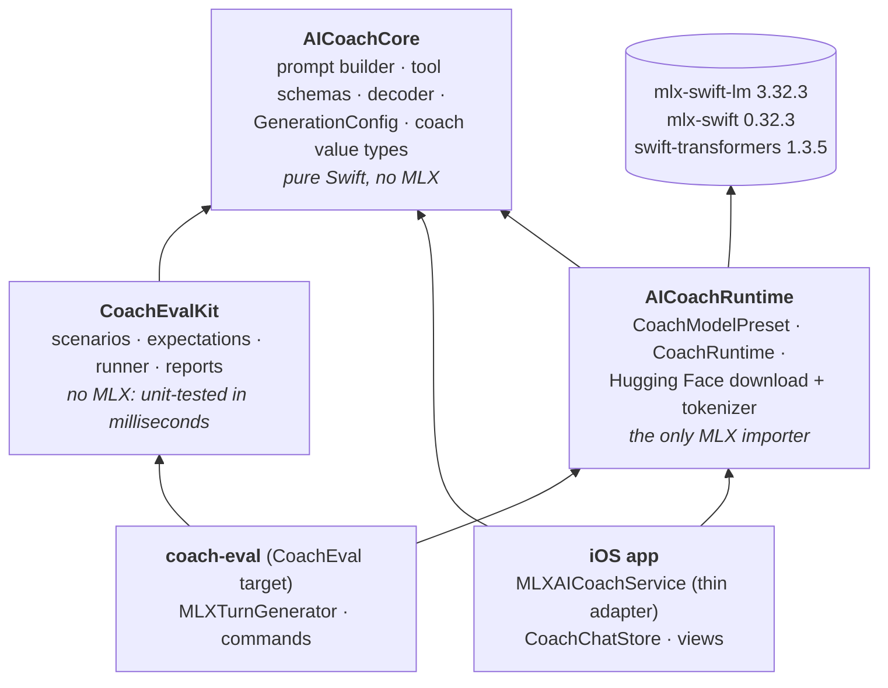
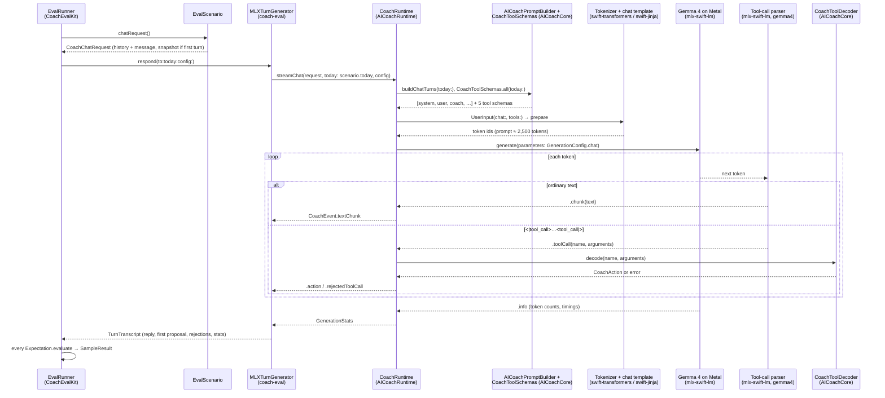

# AI Coach Evals — Guide

A hands-on guide to `Evals/`, the test bed for the on-device AI coach. It covers:

- **Running the suite.** Scenarios go to the *production* model on your Mac's GPU, and each answer is
  graded.
- **Iterating.** Change a prompt, a schema, a sampling parameter, or the model, and measure whether
  the coach got better.
- **Learning the stack.** The suite is small, real Swift that uses the same libraries as the app's AI
  features. Part 3 tours the Swift concepts through this code.

If you want the coach's own architecture (tools, proposals, the chat store), read
[AI_COACH.md](AI_COACH.md). This guide assumes only that you have skimmed its §1 and §7.

## Contents

**Part 1 — Using it**

1. [Quick start](#1-quick-start)
2. [The commands](#2-the-commands)
3. [Reading results](#3-reading-results)

**Part 2 — How it works**

4. [What "the same code as the app" means](#4-what-the-same-code-as-the-app-means)
5. [One turn, end to end](#5-one-turn-end-to-end)
6. [Anatomy of a scenario](#6-anatomy-of-a-scenario)
7. [Metal from the command line](#7-metal-from-the-command-line)

**Part 3 — Working on it**

8. [Recipes](#8-recipes)
9. [A Swift tour through this code](#9-a-swift-tour-through-this-code)
10. [Gotchas](#10-gotchas)
11. [File index](#11-file-index)

---

## 1. Quick start

**You need:**

- An Apple Silicon Mac. MLX runs on the GPU through Metal.
- macOS 14 or later.
- Xcode with the Swift 6.4 toolchain or newer, plus the Metal toolchain. If a build fails with
  `cannot execute tool 'metal'`, run `xcodebuild -downloadComponent MetalToolchain`.
- About 4.5 GB of free disk for the model, downloaded on first use.
- About 6 GB of free RAM while a run is going.

```bash
cd Evals

./coach-eval list                                   # what scenarios exist
./coach-eval inspect --scenario record-yesterday    # exactly what the model will be sent (no model)
./coach-eval run --scenario record-yesterday        # run one scenario, 3 samples, graded
./coach-eval chat                                   # talk to the coach yourself
swift test                                          # the suite's own unit tests (no model)
```

**The first `run` or `chat` does two slow things, once each:**

1. **Compiles MLX in release mode.** This takes a few minutes. Later builds are incremental and take
   seconds.
2. **Downloads the model.** That's `lmstudio-community/gemma-4-E2B-it-MLX-4bit`, ~4.3 GB, saved to
   `~/Documents/huggingface/models/`, the same Hub cache layout the app uses on a phone. Later runs
   load it from disk in a few seconds.

`./coach-eval` is a thin script around `swift run -c release CoachEval`. Release mode matters: a
debug build of MLX generates several times slower.

---

## 2. The commands

| Command | Needs the model? | What it's for |
|---|---|---|
| `list [--details]` | no | Scenario ids, titles, tags. `--details` adds each one's summary and checks. |
| `inspect --scenario ID [--no-tools]` | no | Prints the system turn, user turns, and tool schemas exactly as `CoachRuntime` builds them, at the scenario's pinned date. The fastest loop for prompt edits. |
| `chat [--scenario ID] [--real-date] [--events]` | yes | An interactive conversation with the real model, using a scenario's training snapshot. Shows proposals, rejections, and tokens/sec. `/prompt` prints what the next message will be sent with; `/reset` starts over. |
| `run [--scenario ID]… [--tag T] [--samples N] [--save] [--note "…"] [--verbose] [--strict]` | yes | Runs scenarios, grades every sample, and prints a summary. `--save` writes JSON to `Evals/results/` (git-ignored). `--strict` exits non-zero unless everything passed. |
| `compare [BEFORE.json AFTER.json]` | no | Per-scenario pass rates of two saved runs side by side. With no arguments it compares the two newest. |

`run` and `chat` also accept sampling overrides: `--temperature`, `--top-p`, `--repetition-penalty`,
`--max-tokens`. Without them you get `GenerationConfig.chat`, which is what the app's conversation
uses, so an unflagged run measures production behaviour.

---

## 3. Reading results

`run` prints each sample as it finishes. A failing sample gets its failed checks and its reply
underneath:

```text
▶ record-after-details — Record once the details arrive
  "A bike ride this morning, 45 minutes. Felt strong."
  ✔ sample 1/3  record_workout 2026-10-14 Wed · Bike · 45:00 · feeling 4  (82 tok/s)
  ✔ sample 2/3  record_workout 2026-10-14 Wed · Bike · 45:00 · feeling 4  (80 tok/s)
  ✔ sample 3/3  record_workout 2026-10-14 Wed · Bike · 45:00 · feeling 4  (82 tok/s)

▶ record-separate-ratings — Keep feeling and RPE independent
  "Log today's interval session: 10k in 48 minutes. RPE 8, but I felt strong."
  ✘ sample 1/3  record_workout 2026-10-14 Wed · Interval Run · 10.0 mi · 48:00 · RPE 8 · feeling 5  (78 tok/s)
      ✘ workout distance 6.21 mi — got 10.0 mi
      ✘ workout feeling 4 — got 5
```

Then it prints a summary, with one row per scenario. A scenario passes a sample only if **every**
check passes. Under any row that isn't 100%, the summary breaks the rate down per check, so you can
see *which* part is flaky:

```text
✔ record-after-details       3/3       82 tok/s
✘ record-separate-ratings    0/3       81 tok/s
    2/3  proposes record_workout
    2/3  workout dated today
    0/3  workout distance 6.21 mi
    0/3  workout feeling 4
~ overtraining-advice        1/3       83 tok/s
    1/3  reply mentions any of rest/recover/easy/reduce/back off/fatigue/lighter
```

`✔` means every sample passed, `~` means some did, and `✘` means none did.

**Why `--samples` defaults to 3, and why scores move.** The coach samples with temperature 0.6, so
the same prompt gives different answers on different runs. That is also true on a phone. One sample
tells you very little, and a pass rate over several tells you more. Some rough rules:

- **3 samples** is for quick iteration ("did my edit break this?").
- **5–10 samples** is for comparing two versions with `compare`. A one-sample swing out of 3 is 33
  points, which is noise, not signal. `compare` warns you below 5.
- **`--temperature 0`** makes runs (nearly) deterministic. That's useful when you're debugging one
  prompt path. Remember the app doesn't run at 0, so don't tune to it.

**What "good" looks like.** A small model won't hit 100% on everything, and chasing it can overfit
the prompt to these exact sentences. Track the trend across runs (`--save` + `compare`). Treat a
scenario that drops from 5/5 to 2/5 after an edit as a real regression.

**Saved runs** (`results/*.json`) record:

- the git commit, with `-dirty` when you had uncommitted edits (usually the prompt change you're
  testing);
- your `--note`;
- the model id and every sampling parameter;
- every sample's checks, reply, proposal, rejections, and token stats.

They're plain JSON, so `jq` works on them. For example, to see every proposal a scenario produced:

```bash
jq -r '.scenarios[] | select(.id == "record-yesterday") | .samples[].proposal' results/<file>.json
```

### The first baseline (2026-11-04)

The first run of the suite against the shipping model (Gemma 4 E2B on the app's pinned package
versions, `GenerationConfig.chat`, 3 samples, ~83 tok/s on an M-series Mac) passed **45%** of
samples. Each failure below was checked by
hand and is a real model behaviour, not an eval bug. That makes them good first targets for prompt
iteration:

| Scenario | Result | What the model does |
|---|---|---|
| `strength-plan-day`, `strength-add-one`, `strength-move`, `chat-no-data` | 3/3 | Correct. |
| `record-after-details` | 2/3 | Correct, except "felt strong" sometimes recorded as feeling 5. |
| `record-yesterday` | 0/3 | Dates "yesterday" as **today**, and sometimes invents `RPE 4 · feeling 5`. With an empty snapshot it gets the date right, so the nearby dates in the training data seem to pull it off the anchor. |
| `record-ask-first` | 0/3 | Calls `record_workout` with nothing filled in (rejected: no `exercise_type`) instead of asking. The athlete would see only the "I started to suggest something" apology. |
| `record-separate-ratings` | 0/3 | Records **10k as 10.0 miles**, 48 minutes as 46:40, and "felt strong" as feeling 5 instead of 4. RPE stays independent (8), which is what the scenario guards. |
| `schedule-shorten-tomorrow` | 0/3 | Picks a change but omits its new value (rejected: no `duration_seconds`). |
| `overtraining-advice` | 1/3 | Praises "solid volume" and asks how the athlete feels, rather than advising them to back off. |
| `strength-offload` | 0/3 | Uses `remove` (deleting lift history) where "for now" calls for `offload`. |

Save your own baseline with `./coach-eval run --samples 5 --save --note baseline` before changing
anything, and compare against it.

---

## 4. What "the same code as the app" means

The old evals had an important limitation. Swift built the prompt, but a separate Python program
(`mlx-lm`) loaded a *different* model (Gemma 3) and generated from it, and only the legacy one-shot
prompt was scored. Its numbers could not tell you much about the app.

Now everything that touches the model lives in one package, used by both the app and the evals:



Concretely, when the evals generate a turn, they call
`CoachRuntime.streamChat(request, today:, config:)`. That is the method `MLXAICoachService.streamChat`
calls in the app, and it builds the same thing in both places:

- the same model and tool-call dialect (`CoachModelPreset.production`);
- the same prompt turns (`AICoachPromptBuilder.buildChatTurns`);
- the same tool schemas (`CoachToolSchemas.all(today:)`);
- the same tool-call decoding (`CoachToolDecoder` via `CoachEventMapping`).

The evals also mirror the two rules the app applies *after* generation:

- **First proposal wins.** `TurnTranscript.fold` copies `CoachChatStore.stream`'s rule.
- **Snapshot on the first request only.** `EvalScenario.chatRequest()` copies `CoachChatStore.send`.

The pinned versions match too. `Evals/Package.resolved` pins mlx-swift-lm, mlx-swift,
swift-transformers, and swift-jinja (which renders the chat template) to the versions in the app's
`Package.resolved`.

**What still differs from a phone:**

- **Memory pressure.** The phone caps MLX's buffer cache at 20 MB and can still be killed by jetsam.
  The Mac has room.
- **Speed.** An M-series Mac is several times faster than an iPhone.
- **Numerics.** GPU kernels differ slightly between chips. Tokens can diverge late in a long
  generation, but behaviour is the same in distribution.

So: **the evals answer "does the coach behave correctly?"; a device run answers "does it fit and is it
fast enough?"**

---

## 5. One turn, end to end

What happens for one sample of one scenario:



The model never "calls" anything. It writes text in a special format
(`<|tool_call>call:record_workout{date:<|"|>2026-10-13<|"|>,…}<tool_call|>`). mlx-swift-lm's parser
for the `gemma4` format spots that text and lifts it out as a structured call. The parser has to be
told which dialect to expect, which is why the preset carries a `toolCallFormat`. Our decoder then
validates every field. If a field is out of range or missing, you get a rejection, never a silently
clamped value.

---

## 6. Anatomy of a scenario

Here is `record-yesterday` from `Sources/CoachEvalKit/Scenarios/RecordScenarios.swift`:

```swift
public static let recordYesterday = EvalScenario(
    id: "record-yesterday",
    title: "Record a fully described workout",
    summary: "Date, type, distance, and duration are all given. …",
    tags: ["record", "dates"],
    snapshot: Fixtures.typicalWeek,                      // ① training data
    athleteMessage: "I ran an easy 5 miles yesterday in 42 minutes.",   // ②
    expectations: [                                      // ③
        .proposes(.recordWorkout),
        .workoutOn(day: -1),
        .workoutType(.easyRun),
        .workoutDistance(miles: 5),
        .workoutDuration(seconds: 42 * 60),
        .noRejections,
    ]
)
```

1. **The snapshot** is the `CoachingRequest` the app would build from SwiftData: recent workouts, the
   upcoming plan, and the strength board. `Fixtures.swift` has three of them: `typicalWeek`,
   `overtraining`, and `empty`. All their dates are offsets from **`EvalCalendar.today`**, which is
   pinned to **Wednesday 2026-10-14**. The scenario also passes that date to the model as "today", so
   "yesterday" always means Tuesday the 13th. Without the pin, a scenario's meaning would change
   with the day you ran it.
2. **The athlete's message** is the one turn the model generates a response to. For multi-turn
   cases, `history:` holds scripted earlier turns (see `recordAfterDetails`). Scripting them, rather
   than generating them, means each scenario tests one decision. A bad first answer can't cascade.
3. **Expectations** are checks on the *folded* turn (`TurnTranscript`). Each one is a label plus a
   pure function returning a `Verdict` (pass/fail plus a detail string).

    | Family | Checks |
    |---|---|
    | Turn shape | `.proposes(tool)`, `.noProposal`, `.noRejections` |
    | Reply text | `.replyNotEmpty`, `.replyAsksQuestion`, `.replyMentionsAny([…])`, `.replyOmits([…])`, `.maxWords(n)` |
    | Payload | `.workoutOn(day:)`, `.workoutType`, `.workoutDistance`, `.workoutDuration`, `.workoutExertion`, `.workoutFeeling`, `.scheduleChangeOn(day:)`, `.scheduleChangeKind(…)`, `.strengthDayOn("Tuesday")`, `.strengthDayExerciseCount(range)`, `.strengthUpdateTargets(day, nameContaining:)`, `.strengthUpdateKind(kind, to:)` |
    | Free-form | `.scheduleChange("label") { … }`, `.strengthDay("label") { … }`, or the generic `.payload(…)` |

**Every scenario encodes an invariant.** The starter library is built around the rules in
`CLAUDE.md` and [AI_COACH.md §17](AI_COACH.md#17-design-invariants-do-not-regress):

| Scenario | Invariant it guards |
|---|---|
| `record-yesterday` | The model has no clock. Relative dates must resolve against the system turn. |
| `record-ask-first` | A tool call is the last step. "Can you record a workout for me" must get a question back, not a guess. |
| `record-after-details` | A multi-turn follow-up. It also runs *without* the snapshot, as the app does on turn two (see [§10](#10-gotchas)). |
| `record-separate-ratings` | Feeling and RPE are independent. Neither may be derived from the other. |
| `schedule-shorten-tomorrow` | Schedule edits target a real session by date. |
| `overtraining-advice` | Advice is grounded in the data (no invented activity types). |
| `strength-plan-day` | The coach picks the lifts, and the `exercises` field arrives in the flat line format. |
| `strength-add-one` | Adding one exercise is also `plan_strength_day` (it appends). |
| `strength-move`, `strength-offload` | Board edits go through `update_strength_exercise`. "For now" means offload, not remove. |
| `chat-no-data` | With no data, the coach says so and invents nothing. |

---

## 7. Metal from the command line

MLX runs its math as **Metal shaders**, small GPU programs written in `.metal` files inside
mlx-swift. They must be compiled into a `default.metallib` that ships beside the executable.

For a long time, `swift build` didn't do that. Only Xcode's build system compiled `.metal` resources.
A SwiftPM-built tool would start, find no kernels, and produce garbage (typically "Okay here's a"
and then an immediate stop). That's why the old evals generated with Python.

**The SwiftPM in the Swift 6.4 toolchain compiles Metal resources.** After a build you'll find:

```text
Evals/.build/out/Products/Release/mlx-swift_Cmlx.bundle/Contents/Resources/default.metallib
```

MLX finds that bundle beside the `CoachEval` binary at runtime. This was verified when the suite was
built: the first generation was a correct `record_workout` proposal at ~29 tok/s in a debug build
and ~83 tok/s in release.

**If you ever see garbage output again**, for example after a toolchain change, check two things:

1. Does `find Evals/.build -name default.metallib` find anything? If not, the toolchain isn't
   compiling Metal. Make sure the Metal toolchain is installed (see Quick start).
2. As a fallback, build with Xcode's build system, which always compiles shaders, and run the
   product from there. This is mlx-swift's documented route. It hasn't been needed on the current
   toolchain, so it hasn't been exercised here:
   ```bash
   cd Evals
   xcodebuild build -scheme CoachEval -destination 'platform=macOS,arch=arm64' -derivedDataPath .build/xcode
   .build/xcode/Build/Products/Debug/CoachEval run --scenario record-yesterday
   ```

---

## 8. Recipes

### Add a scenario

1. Pick the file in `Sources/CoachEvalKit/Scenarios/` for the area (or start a new
   `extension ScenarioLibrary`).
2. Add a `public static let` scenario. Start from the nearest existing one.
3. List it in `ScenarioLibrary.all`.
4. If you can write down the ideal answer, add it to
   `ScenarioLibraryTests.perfectAnswersPassTheirOwnScenarios` in
   `Tests/CoachEvalKitTests/CoachEvalKitTests.swift`. This test catches a *wrong expectation*
   before you blame the model for it.
5. Run `swift test`, then `./coach-eval inspect --scenario <id>`, then
   `./coach-eval run --scenario <id> --samples 5`.

Tips:

- **Test one decision per scenario.** If you're checking dates, don't also demand a perfect rationale.
- **Use tolerances for numbers** the model has to convert (10k → 6.21 mi ± 0.1).
- **Prefer `replyMentionsAny` with several synonyms** over one exact word.

### Add a kind of expectation

Expectations are static functions on `Expectation` in `Sources/CoachEvalKit/Expectation.swift`. For a
new check on a proposal payload, wrap `payload(_:of:_:check:)`:

```swift
/// The workout carries the athlete's notes.
public static func workoutHasNotes() -> Expectation {
    payload("workout has notes", of: .recordWorkout, \.workout) { workout, _ in
        .check(!(workout.notes ?? "").isEmpty, "notes: \(workout.notes ?? "none")")
    }
}
```

Then add a test for it in `CoachEvalKitTests.swift`, next to the others of its family. Every public
method gets a test (see `CLAUDE.md`).

### A/B a prompt change

```bash
cd Evals
./coach-eval run --samples 5 --save --note "baseline"
# edit Packages/AICoachCore/Sources/AICoachCore/AICoachPromptBuilder.swift (or a schema description)
./coach-eval inspect --scenario record-ask-first   # eyeball the new prompt
./coach-eval run --samples 5 --save --note "ask-first wording v2"
./coach-eval compare                                 # newest two runs
```

The prompt builder is shared, so the app picks up the change too. Update the
`PromptBuilderTests` / `CoachChatPromptTests` assertions in `Packages/AICoachCore` to match.

To iterate on one scenario quickly, use `--scenario <id> --samples 3`, or `--tag strength` for a
family.

### Tune generation parameters

Try them from the command line first:

```bash
./coach-eval run --samples 5 --save --temperature 0.4 --note "temp 0.4"
./coach-eval compare
```

If a setting wins, change `GenerationConfig.chat` in
`Packages/AICoachCore/Sources/AICoachCore/GenerationConfig.swift`. Both the app and the evals' defaults
read it. Leave `repetitionPenalty` at 1.2. Below that, the model loops.

### Try a different model

The model is a `CoachModelPreset` (`Packages/AICoachRuntime/Sources/AICoachRuntime/CoachModelPreset.swift`).
To evaluate a candidate without touching the app:

1. Add a preset next to `production`:
   ```swift
   public static let candidate = CoachModelPreset(
       id: "mlx-community/<some-mlx-4bit-repo>",
       extraEOSTokens: ["<turn|>"],     // the family's end-of-turn token
       toolCallFormat: "gemma4",         // a ToolCallFormat raw value: json, gemma, gemma4, qwen3_5, …
       approximateDownloadBytes: 0
   )
   ```
2. In `Evals/Sources/CoachEval/Support/MLXTurnGenerator.swift`, change `ModelLoader.loadProduction`
   to use `.candidate`, or add a `--model` option that picks between presets.
3. Run `./coach-eval run --samples 5 --save` on each preset, then `compare`. Each saved run records
   its model id.

A wrong `toolCallFormat` doesn't error. Tool calls simply arrive as plain text in the reply. If every
`proposes` check fails while the replies contain `call:` or `<tool_call>`, the format is wrong. See
[MODEL_UPGRADE.md](MODEL_UPGRADE.md) for what a production switch involves.

### Debug a rejected tool call

1. Reproduce it in chat with raw events visible:
   ```bash
   ./coach-eval chat --scenario strength-plan-day --events
   ```
   You'll see `.rejectedToolCall(reason: …)` as it arrives. Reasons come from two places: mlx-swift-lm's
   parser (e.g. `unknownTool`), or `CoachToolDecodeError`'s description in
   `Packages/AICoachCore/Sources/AICoachCore/CoachToolDecoding.swift`.
2. `/prompt` shows the exact turns. Check whether the schema description or the preamble asks for
   what the decoder enforces.
3. For a deterministic reproduction, add `--temperature 0`.

### Write a test for the CLI-free parts

Everything in `CoachEvalKit` runs without a model. `ScriptedGenerator` stands in for the GPU:

```swift
let generator = ScriptedGenerator { request, sampleIndex in
    sampleIndex == 0 ? [.textChunk("What did you do?")] : [.action(.recordWorkout(proposal))]
}
let record = await EvalRunner(generator: generator, samples: 2).run([ScenarioLibrary.recordAskFirst])
#expect(record.scenarios[0].passCount == 1)
```

---

## 9. A Swift tour through this code

Each concept below points to where it's used here. Read the file next to the explanation. These are
the patterns the app's AI features are built from.

### Packages, targets, and products

A **package** (`Package.swift`) declares **targets**, which are modules (one folder of sources each),
and the **products** other packages may use. `Evals/Package.swift` has three targets:

- `CoachEvalKit` is a library.
- `CoachEval` is an executable.
- `CoachEvalKitTests` holds the tests.

A target sees only the modules it lists as dependencies. That's how the design *enforces*
"CoachEvalKit has no MLX". If someone adds `import MLX` there, it won't compile.

`.package(path: "../Packages/AICoachRuntime")` is a **local package dependency**, which is how the
app's Xcode project uses it too. `Package.resolved` pins exact versions of remote packages.

### Access control: `public`, `internal`, `private`

By default a declaration is **internal**, visible only inside its own module. Anything another module
needs must be `public`. That's why `CoachRuntime`'s API, the moved `HuggingFaceDownloader`, and every
CoachEvalKit type the CLI touches are marked `public`.

`@testable import CoachEvalKit` in the tests lifts internal declarations so tests can reach them,
like `ProposalSummary.clock`.

### Value types (`struct`, `enum`) vs. reference types (`class`, `actor`)

Most types here are **structs**: `EvalScenario`, `TurnTranscript`, `Verdict`, `RunRecord`. A struct is
copied on assignment. You can't accidentally share and mutate one from two places, which makes
reasoning (and concurrency) simpler.

A `mutating func` is a method that changes `self`, like `TurnTranscript.fold`. It can only be called
on a `var`.

**Classes** are used only where identity or shared mutable state is the point:

- `CoachRuntime` holds one loaded multi-gigabyte model that everyone shares.
- `StatsBox` is written by one callback and read later.

### Enums with associated values

`CoachEvent` (in AICoachCore) is the backbone of the coach:

```swift
public enum CoachEvent {
    case textChunk(String)
    case action(CoachAction)
    case rejectedToolCall(reason: String)
}
```

Each case carries its own data. A `switch` must handle every case, so adding a case makes the
compiler point at every place that needs updating. See `TurnTranscript.fold`. Note the
`case .action(.reply(let text))` pattern there, which matches *inside* a nested enum.
`CoachAction.workout` (in `Expectation.swift`) uses `if case` to pull out one case's payload as an
optional.

### Closures, and why `Expectation` is a struct holding one

A **closure** is a function value. `Expectation` stores
`let evaluate: @Sendable (TurnTranscript, EvalScenario) -> Verdict`, and each static factory returns a
different closure:

```swift
public static func maxWords(_ limit: Int) -> Expectation {
    Expectation("at most \(limit) words") { transcript, _ in          // trailing-closure syntax
        .check(transcript.wordCount <= limit, "\(transcript.wordCount) words")
    }
}
```

The closure **captures** `limit`. A new check is one new function, with no central `switch` to grow.
This is a common Swift trade-off: an enum is best when you need to match on *which* kind; a closure is
best when you only need to *run* it.

`.proposes(.recordWorkout)` with a leading dot is **implicit member syntax**. Because the array is
typed `[Expectation]`, Swift looks the name up on `Expectation`.

### Generics and key paths

`Expectation.payload` is generic over `Payload`:

```swift
public static func payload<Payload>(
    _ label: String, of tool: CoachTool,
    _ extract: @escaping @Sendable (CoachAction) -> Payload?,
    check: @escaping @Sendable (Payload, EvalScenario) -> Verdict
) -> Expectation
```

Callers pass a **key path** like `\.workout` as the `extract` function. Swift converts
`\CoachAction.workout` into `(CoachAction) -> WorkoutProposal?` and infers `Payload` is
`WorkoutProposal`, so the `check` closure receives a typed `WorkoutProposal`. One helper covers all
four proposal kinds.

### Optionals

`Int?` means "an `Int` or `nil`". The coach's data uses this deliberately: `feeling: nil` means "the
athlete didn't say", which is different from any number. You'll see:

- `if let` / `guard let` to unwrap;
- `?? default` for fallbacks;
- `.map { … }` to transform only when present, e.g. `w.distanceMiles.map { String(format: "%.1f mi", $0) }`;
- `compactMap` to drop the `nil`s from an array (`ProposalSummary.describe`).

### Protocols and test doubles

`CoachTurnGenerator` is a **protocol**, a contract: "give me a `TurnTranscript` for this request". The
runner holds `any CoachTurnGenerator`, so it can't tell the real model (`MLXTurnGenerator`) from
`ScriptedGenerator`. That's the same pattern as the app's `AICoachService`, with `MLXAICoachService`
and `StubAICoachService` behind it. It's why almost all of the suite is testable in milliseconds.

### async/await

`async` functions can suspend while waiting (for the GPU, the network, or disk) without blocking a
thread. `await` marks each point where that can happen. `func run() async throws` in `RunCommand`
awaits the model load and each generated turn in sequence.

### `AsyncThrowingStream`: values over time

`CoachRuntime.streamChat` returns `AsyncThrowingStream<CoachEvent, Error>`, a sequence whose elements
arrive over time and that may end with an error. You consume it with:

```swift
for try await event in runtime.streamChat(request, today: today, config: config) { … }
```

Inside `streamChat`, a `Task` produces events with `continuation.yield(…)` and ends with
`finish()`. `continuation.onTermination = { _ in task.cancel() }` stops the GPU work if the consumer
stops listening, for example when the athlete taps Stop in the app.

### `Sendable`, actors, and data races

Swift checks at compile time that values crossing between concurrent tasks are safe to share.

- **`Sendable`** marks types that are safe to share. Most structs of `Sendable` fields qualify
  automatically.
- **`@Sendable` closures** may run on another thread, so they may only capture `Sendable` things.
- **An `actor`** protects its own mutable state by running one caller at a time. `ScriptedGenerator`
  is an actor so its `callCount` can't race. Note `await generator.callCount` in the tests: reading
  actor state from outside is asynchronous.
- **`@unchecked Sendable` with a lock** (`StatsBox`, `ByteRateMeter`) is the manual escape hatch for
  state touched from synchronous callbacks that can't `await`. Use it sparingly.

In `CoachRuntime`, `UserInput` is *not* `Sendable`, so it's built **inside**
`container.perform { context in … }`, the closure that runs with exclusive access to the model,
rather than captured from outside.

### Codable

`RunRecord` and everything inside it conform to `Codable`, so
`JSONEncoder().encode(record)` / `JSONDecoder().decode(RunRecord.self, from:)` just work. Swift
synthesizes the code from the stored properties. `GenerationConfig` from AICoachCore is Codable too,
which is how saved runs record their sampling parameters.

### Conditional compilation

`#if canImport(MLXLLM) … #else … #endif` compiles one branch or the other, depending on whether a
module is available. AICoachRuntime keeps every MLX line behind it, with fallbacks that throw
`CoachRuntimeError.runtimeUnavailable`, so its tests (and anything depending on it) can build where
MLX can't.

### Swift Testing

Tests use `import Testing`:

- **`@Test`** marks a test function.
- **`#expect(condition)`** checks a condition and keeps going on failure.
- **`try #require(x)`** unwraps an optional or stops the test.
- **Plain structs group tests** into suites.

Run them with `swift test`, or `swift test --filter EvalRunnerTests` for one suite. XCTest is still
used for the app's UI tests (see `CLAUDE.md`).

### swift-argument-parser

Each command is a struct conforming to `ParsableCommand` or `AsyncParsableCommand`:

- `@Option`, `@Flag`, and `@Argument` properties become command-line options, with help text
  generated from `help:`.
- `@OptionGroup var generation: GenerationOptions` reuses one set of options in two commands.
- `validate()` runs before `run()`, which is the place to reject bad input with `ValidationError`.

Try `./coach-eval run --help`.

### Where MLX itself shows up

Only in `Packages/AICoachRuntime/Sources/AICoachRuntime/CoachRuntime.swift` and `ModelLoading.swift`.
The key mlx-swift-lm APIs:

| API | Role |
|---|---|
| `LLMModelFactory.shared.loadContainer(from:using:configuration:)` | Downloads (via our `HuggingFaceDownloader`) and loads weights + tokenizer into a `ModelContainer` |
| `ModelConfiguration(id:extraEOSTokens:toolCallFormat:)` | Which repo, when to stop, and which tool-call dialect to parse |
| `ModelContainer.perform { context in … }` | Exclusive, serialized access to the model |
| `UserInput(chat:tools:)` → `context.processor.prepare(input:)` | Applies the chat template (Jinja) and tokenizes |
| `MLXLMCommon.generate(input:parameters:context:tools:)` | Returns `AsyncStream<Generation>`: `.chunk`, `.toolCall`, `.rejectedToolCall`, `.info` |
| `GenerateParameters` | Sampling: temperature, top-p, repetition penalty, max tokens |
| `MLX.Memory.cacheLimit` | GPU buffer cache cap (set on iOS only) |

A good exercise: read `generateChat` in `CoachRuntime.swift` with the sequence diagram in
[§5](#5-one-turn-end-to-end) open beside it.

---

## 10. Gotchas

- **The snapshot is sent only with the first request**, as in the app. `CoachChatStore` stores the
  athlete's plain text and sends `context` only on its first request, so from turn two on the model
  sees *no training data at all*. `EvalScenario.chatRequest()` reproduces this. Scenarios with
  `history` (like `record-after-details`) run without the snapshot. If the app changes to keep the
  snapshot, change `chatRequest()` too, and the multi-turn scenarios will start seeing it. This is
  listed as a known gap in [AI_COACH.md §19](AI_COACH.md#19-known-gaps-and-gotchas).
- **Swift Testing has its own `Expectation` type.** In the test file, ours is disambiguated with
  `private typealias Expectation = CoachEvalKit.Expectation`.
- **`today` is pinned; `chat --real-date` unpins it.** Fixture dates are relative to the pin, so with
  `--real-date` the snapshot's workouts are still dated around 2026-10-14.
- **Proposals don't enter the transcript.** As in the app, a coach turn's history entry is its reply
  text only. In `chat`, the model doesn't "remember" a proposal it made unless its text mentioned it.
- **First run is slow and big**: a release build of MLX, then a 4.3 GB download.
- **Changing an AICoachCore type breaks the app too.** That's the point of sharing it. Run the app's
  unit tests (`CLAUDE.md`) after changing anything in `Packages/`.
- **Keep the pins in step.** SwiftPM resolves each package on its own, so `Evals/Package.resolved`
  can drift from the Xcode project's pins. It once picked up swift-jinja 3.0.0, which renders the
  chat template, while the app used 2.5.1. `PinnedVersionsTests` (part of `swift test`) fails when
  mlx-swift, mlx-swift-lm, swift-transformers, swift-jinja, or swift-huggingface differ from the app.
  To fix it, copy the app's pins for those packages into `Evals/Package.resolved` and
  `Packages/AICoachRuntime/Package.resolved`, then run `swift package resolve`.

---

## 11. File index

| Path | What it is |
|---|---|
| `Evals/coach-eval` | Wrapper: `swift run -c release CoachEval "$@"` |
| `Evals/Package.swift` | Targets: `CoachEvalKit` (library), `CoachEval` (CLI), `CoachEvalKitTests` |
| `Evals/Sources/CoachEvalKit/EvalScenario.swift` | A scenario; `chatRequest()` mirrors the app's request |
| `…/CoachEvalKit/EvalCalendar.swift` | The pinned date and day arithmetic |
| `…/CoachEvalKit/Expectation.swift` | `Verdict`, `Expectation`, all check factories, `CoachAction` payload accessors |
| `…/CoachEvalKit/TurnTranscript.swift` | Event → turn fold (first proposal wins), `TurnStats` |
| `…/CoachEvalKit/CoachTurnGenerator.swift` | The generator protocol; `ScriptedGenerator` |
| `…/CoachEvalKit/EvalRunner.swift` | Runs × samples, grading, `EvalProgress` |
| `…/CoachEvalKit/RunRecord.swift` | Codable results: `RunRecord`, `ScenarioResult`, `SampleResult`, `CheckResult` |
| `…/CoachEvalKit/ReportFormatter.swift` | Terminal output; `RunComparison` |
| `…/CoachEvalKit/ProposalSummary.swift` | One-line proposal rendering |
| `…/CoachEvalKit/Scenarios/` | `Fixtures`, `ScenarioLibrary`, and the scenarios by area |
| `Evals/Sources/CoachEval/CoachEvalCLI.swift` | `@main` command group |
| `…/CoachEval/Commands/` | `run`, `chat`, `inspect`, `compare`, `list` |
| `…/CoachEval/Support/MLXTurnGenerator.swift` | `CoachRuntime`-backed generator; model loading with progress |
| `…/CoachEval/Support/CLISupport.swift` | Shared sampling options, terminal, git, paths |
| `Evals/Tests/CoachEvalKitTests/` | Unit tests for everything model-free, plus `PinnedVersionsTests` (eval stack == app stack) |
| `Packages/AICoachRuntime/` | `CoachModelPreset`, `CoachRuntime`, `CoachEventMapping`, Hugging Face loading |
| `Packages/AICoachCore/` | Prompt builder, tool schemas, decoder, `GenerationConfig`, coach value types |
