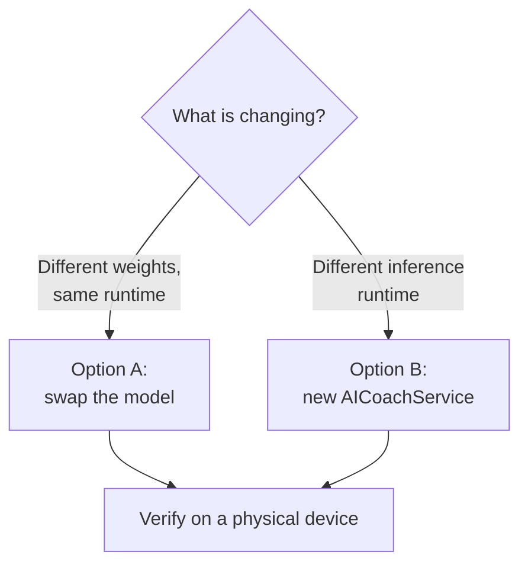

# Changing the Coach Model or Runtime

## Current State

The AI coach runs **Gemma 4 E2B, instruction-tuned, MLX 4-bit**
(`lmstudio-community/gemma-4-E2B-it-MLX-4bit`, ~4.3 GB) on **mlx-swift-lm 3.32.3**
(mlx-swift 0.32.3), with swift-transformers 1.3.5 for Hugging Face access and tokenization.
The weights download from Hugging Face when the athlete taps Download in the coach chat and are
cached for offline use. Sampling parameters live in `AICoachCore.GenerationConfig`. The live chat
uses the `.chat` preset.

History:

| Date | Change |
|---|---|
| 2026-04-06 | Gemma 4 E2B chosen ([ADR 1](adrs/1-use-lightweight-onboard-llm.md)) but couldn't load on MLXLLM 2.29.1 |
| 2026-04-08 | Fell back to Gemma 3 4B QAT (`mlx-community/gemma-3-4b-it-qat-4bit`) |
| 2026-10-14 | mlx-swift-lm 3.32.3 added native `gemma4`; switched to Gemma 4 E2B and to tool calling |

The Gemma 4 migration this document used to describe is **done**. What follows is the checklist for
the *next* model or runtime change. See [AI_COACH.md](AI_COACH.md) for how the coach works.

## Option A: Swap the model (same runtime)

1. **Pick a loadable repo.** It must be an MLX conversion that mlx-swift-lm can load: an
   `LLMTypeRegistry` model type, `.scales`/`.biases` tensors, and a `group_size` in its
   quantization config. Google QAT exports such as `mlx-community/gemma-4-E2B-it-qat-mobile` fail on
   the missing `group_size`.
2. **Update `CoachModelPreset.production`** (`Packages/AICoachRuntime/Sources/AICoachRuntime/CoachModelPreset.swift`).
   The app and the evals both read it:
   - `id`
   - `approximateDownloadBytes`: the CTA shows this before any network call, so keep it in step with `id`
   - `toolCallFormat` (the raw value of mlx-swift-lm's `ToolCallFormat`) and `extraEOSTokens` for the
     model family (Gemma 4: `"gemma4"` + `<turn|>`; Gemma 3: `"gemma"` + `<end_of_turn>`)
3. **Re-check the tool-argument dialect.** Gemma 4's `<|"|>` string escape is the reason every tool
   argument is scalar (see `CLAUDE.md` and [AI_COACH.md §9](AI_COACH.md#9-tools)). A different
   family may parse nested values. Don't loosen the schemas without testing on a device.
4. **Re-check memory.** Compare weight size with the current 4.3 GB and test the smallest supported
   device for jetsam. `MLXAICoachService` keeps the runtime's `memoryCacheLimit` at 20 MB.
5. **Re-tune `GenerationConfig`** if output degrades (repetition, rambling, tool-call spam).
6. **Measure it with the evals.** Before switching `production`, add the candidate as a second
   preset and A/B it: `./coach-eval run --samples 5 --save` on each, then `./coach-eval compare`. See
   [EVALS_GUIDE.md](EVALS_GUIDE.md#try-a-different-model).
7. **Update docs:** `CLAUDE.md`, `README.md`, `docs/AI_COACH.md`, `docs/ARCHITECTURE.md`, and ADR 1 (add an amendment).
8. **Verify on a physical device** with an Xcode build for memory and speed. The evals cover
   behaviour; the simulator can't run Metal inference.

## Option B: Swap the runtime (e.g. LiteRT-LM)

Google's LiteRT-LM Swift SDK was "In Dev / Coming Soon" when ADR 1 was written. If it, or another
runtime, becomes the better choice:

1. Add the package via SPM, gated behind `#if canImport(...)` like MLX.
2. Implement a new `AICoachService` conformance that:
   - builds turns with `AICoachPromptBuilder.buildChatTurns(for:today:)` and tools with `CoachToolSchemas.all(today:)`
   - yields `CoachEvent`s (`.textChunk`, `.action`, `.rejectedToolCall`)
   - decodes every tool call through `CoachToolDecoder`
   - supports `isModelCached`, `isModelReady`, `loadModel()`, `onDownloadProgress`, and `approximateDownloadBytes`, so the opt-in download flow keeps working
3. Inject it in `Hybrid_AIthleticsApp.makeCoachForLaunch()`.
4. Remove the MLX dependencies if nothing else uses them.

The `AICoachService` / `CoachEvent` boundary exists so that no view, store, or test code has to change.

## Where to watch

| Source | What to look for |
|---|---|
| [ml-explore/mlx-swift-lm releases](https://github.com/ml-explore/mlx-swift-lm/releases) | New model types, tool-call parser changes (especially nested-argument handling for Gemma) |
| [google-ai-edge/LiteRT-LM](https://github.com/google-ai-edge/LiteRT-LM) | A stable Swift SDK |
| Hugging Face `mlx-community` / `lmstudio-community` | Smaller MLX-loadable Gemma 4 builds |
